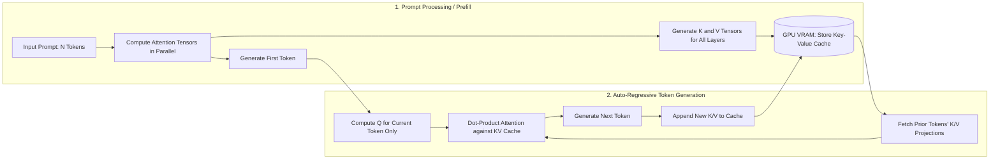
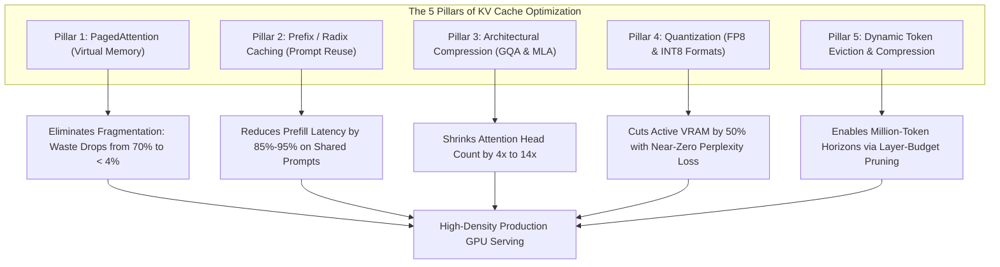
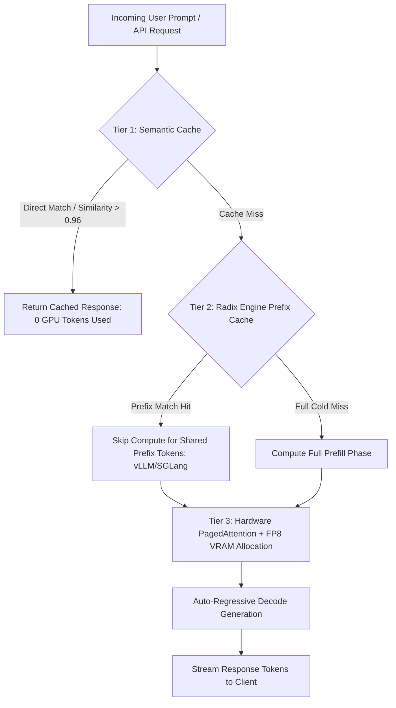

The economics of Large Language Model (LLM) serving have fundamentally inverted. While early infrastructure planning focused on fitting model weights into GPU VRAM, the emergence of 32K, 128K, and 1M+ token context windows means that dynamic **Key-Value (KV) cache memory** now represents the dominant operational cost. In production agentic loops and high-throughput RAG systems, the KV cache accounts for 60% to 90% of active VRAM and dictates the concurrent request capacity of your GPU cluster.

Failing to optimize the KV cache results in severe underutilization of expensive hardware, premature Out-of-Memory (OOM) crashes, and astronomical cloud computing bills. By implementing modern memory paging, radix-based prefix caching, and 8-bit quantization, infrastructure teams can reduce inference costs by 4x to 40x without degrading output quality.

---

## Anatomy of the KV Cache: Prefill vs. Decode Phases

To understand why the KV cache dominates inference budgets, we must examine the computational lifecycle of an auto-regressive Transformer model:



### The Linear Memory Equation

The physical memory footprint required to store the KV cache for a single request scales according to a deterministic equation:

$$\text{KV Cache Size (Bytes)} = 2 \times n_{\text{layers}} \times n_{\text{kv\_heads}} \times d_{\text{head}} \times L \times P$$

Where:
* $n_{\text{layers}}$ is the total number of Transformer layers.
* $n_{\text{kv\_heads}}$ is the number of Key/Value attention heads.
* $d_{\text{head}}$ is the dimension of each attention head.
* $L$ is the total sequence context length (prompt tokens + generated tokens).
* $P$ is the numerical precision in bytes (e.g. 2 bytes for FP16/BF16, 1 byte for FP8).
* The leading multiplier of $2$ accounts for both the Key ($K$) and Value ($V$) matrices.

For a model like Llama 3.3 70B (80 layers, 8 KV heads with GQA, head dimension 128) operating at standard BF16 precision, a single 64K-token request consumes **20.97 GB of pure KV cache VRAM**—excluding model weights.

---

## The Five Pillars of KV Cache Optimization

Production inference engines (including **vLLM 0.7+**, **SGLang**, and **TensorRT-LLM**) implement a layered five-pillar optimization stack to compress memory and maximize throughput.



---

## Pillar 1: PagedAttention (Eliminating Memory Fragmentation)

Historically, deep learning runtimes allocated contiguous virtual memory buffers sized to the absolute maximum potential context length (e.g. reserving 8K tokens of space even if a request only used 500 tokens). This caused two forms of waste:
* **Internal Fragmentation**: Space reserved for future tokens that the user never generated.
* **External Fragmentation**: Memory gaps between requests that were too small to fit another batch sequence.

Inspired by virtual memory paging in operating systems, **PagedAttention** partitions the KV cache into fixed-size physical blocks (e.g. 16 tokens per block).

```
Traditional Contiguous Allocation vs. PagedAttention:

[Traditional Allocation: Heavy Waste]
Request 1: [Tokens 1-500 | ---------------- Unused Reserved Space (7,500 Tokens) ----------------]

[PagedAttention Allocation: Physical Blocks Mapped Non-Contiguously]
Block Table:
  Logical Block 0 -> Physical Block 42  (Tokens 0-15)
  Logical Block 1 -> Physical Block 108 (Tokens 16-31)
  Logical Block 2 -> Physical Block 19  (Tokens 32-47)
[Physical VRAM is 96%+ utilized across all concurrent requests]
```

By allowing logical tokens to reside in non-contiguous physical memory pages, PagedAttention eliminates external fragmentation completely, drops memory waste below 4%, and enables a **2x to 4x increase in concurrent batch size**.

---

## Pillar 2: Prefix Caching with RadixAttention

In agentic loops and enterprise RAG systems, a substantial percentage of tokens are identical across sequential requests: common system prompts, API tool definitions, few-shot demonstration exemplars, or uploaded repository codebases.

Without prefix caching, the inference engine recomputes attention across these identical tokens on every request. **RadixAttention** (pioneered by SGLang) organizes prompt segments into an in-memory Radix Tree:

```
Radix Tree Hierarchy for Shared Prefixes:
[Root: Standard System Instructions (2,048 Tokens)] -> Cached State Stored in VRAM
      ├── Branch A: [Project Alpha Codebase (8,192 Tokens)]
      │         ├── Request 1: "Fix authentication bug"  -> Cache Hit: 10,240 Tokens
      │         └── Request 2: "Add unit tests for jwt"  -> Cache Hit: 10,240 Tokens
      └── Branch B: [Project Beta Documentation (4,096 Tokens)]
                └── Request 3: "Summarize API endpoints" -> Cache Hit: 6,144 Tokens
```

When an incoming request matches a branch in the radix tree, the engine skips the prefill compute pass for the shared prefix, reducing TTFT (Time to First Token) by **85% to 95%** and drastically cutting compute resource consumption.

---

## Pillar 3: Model Architecture Compression (GQA & MLA)

Model architecture design directly impacts the memory footprint of the KV cache:

1. **Multi-Head Attention (MHA)**: Every query head possesses an independent Key and Value head ($n_{\text{kv\_heads}} = n_{\text{q\_heads}}$). Highly expressive, but results in massive cache bloat.
2. **Grouped-Query Attention (GQA)**: Multiple query heads share a single Key/Value head (typically 8 query heads per KV head). Used in Llama 3, Mistral, and Qwen, GQA achieves an immediate **8x memory reduction** over MHA with negligible accuracy loss.
3. **Multi-Head Latent Attention (MLA)**: Introduced in the DeepSeek-V2 and V3 architectures, MLA projects the Key and Value matrices into a low-dimensional compressed latent vector space during training. By storing only the compressed latent vector in the cache and reconstructing keys/values on-the-fly, MLA achieves a **7x to 14x memory reduction** relative to MHA.

---

## Pillar 4: KV Cache Quantization (FP8 and INT8)

By default, attention tensors are stored in 16-bit precision (`FP16` or `BF16`), requiring 2 bytes per element. Modern GPU architectures (such as NVIDIA Ada Lovelace, Hopper, and Blackwell) feature hardware acceleration for 8-bit floating-point numbers (`FP8`).

Quantizing the KV cache to FP8 halves the memory footprint from 2 bytes to 1 byte per token while preserving numerical dynamic range through per-tensor or per-channel scaling factors.

```bash
# Production Example: Launching vLLM with FP8 KV Caching and Prefix Caching
python -m vllm.entrypoints.openai.api_server \
    --model meta-llama/Llama-3.3-70B-Instruct \
    --tensor-parallel-size 4 \
    --kv-cache-dtype fp8 \
    --enable-prefix-caching \
    --gpu-memory-utilization 0.95 \
    --max-model-len 32768
```

Activating `--kv-cache-dtype fp8` cuts active cache VRAM by **50%**, immediately doubling the maximum number of concurrent client requests that fit onto a 4x H100 node.

---

## Implementing a Three-Tier Caching Architecture

To achieve optimal cost efficiency, production AI systems deploy a three-tier caching hierarchy across the infrastructure stack:



1. **Tier 1 (Application Semantic Cache)**: Intercepts repeated or semantically identical queries using a vector cache (e.g. GPTCache or Redis) to bypass GPU inference entirely.
2. **Tier 2 (Engine-Level Prefix Cache)**: Utilizes RadixAttention to preserve shared system prompts and multi-turn chat prefixes across different user sessions.
3. **Tier 3 (Hardware Paged & Quantized Cache)**: Enforces PagedAttention and FP8 precision to maximize physical GPU VRAM density and prevent OOM faults.

---

## Engine Feature Comparison: vLLM vs. SGLang vs. TensorRT-LLM

| Capability / Feature | vLLM (0.7+) | SGLang | NVIDIA TensorRT-LLM |
| :--- | :--- | :--- | :--- |
| **PagedAttention** | Native (Originator) | Native | Native |
| **Prefix Caching** | Native (`--enable-prefix-caching`) | RadixAttention (Advanced LRU) | State Caching |
| **FP8 KV Quantization** | Supported (Hopper / Ada) | Supported | Supported (Highly Optimized) |
| **Chunked Prefill** | Supported | Supported | Supported |
| **Multi-Node Serving** | Supported via Ray | Supported | Supported via MPI |
| **Ease of Deployment** | High (Drop-in Docker container) | High (Fast Python API) | Moderate-Low (Complex Build Pipeline) |
| **Peak Throughput** | Very High | Exceptional on Complex Prompts | Maximum (Native CUDA Kernel Fusion) |

---

## Cost Impact Analysis: Production Benchmarks

The following table models the throughput and cost improvements achieved by progressively stacking KV cache optimizations for a 70B parameter model handling 32K context windows:

| Infrastructure Configuration | Max Concurrent Requests (8x H100) | VRAM per Request (32K Tokens) | TTFT (Time to First Token) | Relative Cost per Million Output Tokens |
| :--- | :--- | :--- | :--- | :--- |
| **Baseline (FP16, No Paging, No Prefix Cache)** | 4 | 24.8 GB | 1,420 ms | \$1.00 (Reference) |
| **+ PagedAttention (vLLM Native)** | 14 | 11.2 GB | 1,380 ms | \$0.32 (68% Savings) |
| **+ FP8 KV Cache Quantization** | 28 | 5.6 GB | 1,290 ms | \$0.16 (84% Savings) |
| **+ Radix Prefix Caching (80% Hit Rate)** | 36 | 5.6 GB | 180 ms | \$0.04 (96% Savings) |

---

## Production Best Practices & Common Pitfalls

### Critical Best Practices

1. **Order Prompts Deterministically**: Prefix caching relies on exact sequential matching from token index 0. Always structure prompts with static elements first:
   ```
   [Static System Instructions] -> [Tool Definitions] -> [RAG Context] -> [Dynamic User Query]
   ```
   Placing a dynamic timestamp or random user ID at the beginning of the prompt invalidates the prefix cache for the entire prompt.
2. **Enable Chunked Prefill**: When a single user submits a 64K-token document, the compute-heavy prefill can stall ongoing decode batches. Enable chunked prefill (`--enable-chunked-prefill` in vLLM) to break large prompts into smaller computational chunks.
3. **Monitor Cache Hit Rates**: Export engine metrics to Prometheus to track `prefix_cache_hit_rate`. A healthy production RAG system should sustain a cache hit rate of 70% or higher.

### Pitfalls to Avoid

* **Over-Allocating GPU Memory**: Setting `--gpu-memory-utilization` to `1.0` frequently triggers CUDA runtime allocations faults. Set this value between `0.90` and `0.95` to leave headroom for CUDA kernels and activation memory.
* **Ignoring Context Window Ceilings**: Allowing unbounded sequence lengths in open-ended agents will eventually exhaust even optimized KV caches. Always enforce hard limits using `--max-model-len`.

---

## Summary Engineering Checklist

- [ ] Serving engine upgraded to modern paging architecture (vLLM 0.7+, SGLang, or TensorRT-LLM).
- [ ] FP8 KV caching enabled on supported hardware (`--kv-cache-dtype fp8`).
- [ ] Prefix caching activated to maximize token reuse across multi-turn sessions.
- [ ] System prompts restructured with static guidelines and schemas placed strictly at the beginning.
- [ ] Chunked prefill enabled to prevent long-context requests from stalling concurrent decode batches.
- [ ] GPU VRAM utilization threshold configured conservatively (0.90–0.95).
- [ ] Cache hit ratios and VRAM fragmentation metrics exported to APM dashboards.

Mastering KV cache optimization transforms LLM serving from an unpredictable cost center into an efficient, predictable infrastructure layer capable of scaling to enterprise workloads.

