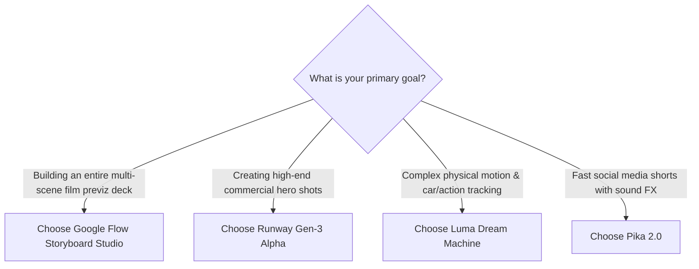

> **Direct Answer for Directors:** **Google Flow Storyboard Studio** is the clear winner for **end-to-end film pre-production and storyboarding**, offering native screenplay parsing, persistent character asset binders, and PDF director's deck exports. For standalone hyper-cinematic video clips, **Runway Gen-3** offers the highest visual fidelity and stylized lighting, while **Luma Dream Machine** provides superior physical camera dynamics, and **Pika 2.0** leads in quick animated meme generation with integrated sound effects.

The generative video landscape in 2026 has matured beyond novelty clips. Directors, advertising agencies, and indie creators now rely on AI video models for complete commercial pitch decks, music video animatics, and feature film pre-visualization.

However, choosing the right tool depends heavily on whether your priority is **narrative multi-scene storyboarding** or **individual hero shot generation**.

We tested **Google Flow (Veo)**, **Runway Gen-3 Alpha**, **Pika 2.0**, and **Luma Dream Machine** across identical screenplay prompts to evaluate prompt adherence, character consistency, camera control, and workflow efficiency.

---

## The Master Comparison Matrix

| Evaluation Dimension | Google Flow (Veo) | Runway Gen-3 Alpha | Pika 2.0 | Luma Dream Machine |
| :--- | :--- | :--- | :--- | :--- |
| **Primary Strength** | Native script-to-storyboard workflow | High-fashion cinematic lighting | Built-in sound FX & meme pacing | Realistic physical momentum & speed |
| **Multi-Shot Storyboard Deck** | **Native Built-in (Best in Class)** | Manual clip-by-clip assembly | Manual timeline clips | Single prompt feed |
| **Character Continuity Binders** | **Yes (Step 2 Asset Binders)** | Custom Elements / Gen-3 Presets | Lip Sync / Pikaffects | Reference Keyframe Mode |
| **Script Ingestion / Parsing** | **Automatic Fountain / Text** | None (Prompt only) | None (Prompt only) | None (Prompt only) |
| **Camera Movement Precision** | High (ASC standard tags) | Excellent (Director Mode UI) | Moderate (Slider controls) | Exceptional (Smooth physical inertia) |
| **Clip Duration (Standard)** | 4.0 Seconds | 5s / 10s Extensions | 3s / 4s Clips | 5.0 Seconds |
| **Audio Synthesis** | Ambient Scratch Track | Lip Sync + Background Gen | Native Sound Effects & Music | Audio-Reactive Video Beta |
| **Export Formats** | MP4, PDF Binder, EDL/XML | MP4, ProRes (Enterprise) | MP4, GIF | MP4 |
| **Pricing Model** | Free Labs Credits / Vertex AI | Subscription (\$15 - \$95/mo) | Subscription (\$10 - \$70/mo) | Subscription (\$30 - \$100/mo) |

[SCREENSHOT: Multi-window comparison showcasing the same character prompt rendered across Google Flow, Runway Gen-3, Pika, and Luma]

---

## 1. Google Flow: The Director's Pre-Production Suite

Google Flow is not merely an AI video generator; it is a full pre-production operating system.

### Where Google Flow Dominates:
- **Zero-Friction Script Breakdown:** Paste an entire 5-page script into Step 1, and Storyboard Studio automatically breaks down scenes, extracts character profiles, and creates formatted visual panels.
- **Cross-Shot Asset Persistence:** Once you upload character portraits in Step 2, the model locks latent embeddings across all panels, virtually eliminating character drift as outlined in our [character consistency guide](https://nadhebe.com/tutorials/how-to-keep-characters-consistent-in-google-flow/).
- **Exporting for Crew Handoffs:** With one click, export a printable PDF director's binder complete with scene numbers, lens tags, and dialogue lines.

### Limitations:
- Generating high volumes of video requires navigating experimental Google Labs rate limits, as detailed in our guide to [Google Flow pricing, credits, and limits](https://nadhebe.com/guides/google-flow-pricing-credits-limits-explained/).
- Slower batch rendering compared to mature commercial SaaS platforms.

---

## 2. Runway Gen-3 Alpha: The Cinematic High-Fashion Heavyweight

Runway remains the gold standard for high-contrast commercial advertising aesthetics and volumetric atmospheric lighting.

### Where Runway Dominates:
- **Advanced Director Mode:** Provides precise numerical sliders for Pan, Tilt, Zoom, Roll, and Pedestal motion controls.
- **Motion Brush Multi-Layering:** Allows you to isolate five distinct areas of an image and assign independent motion trajectories to each (e.g., waterfall falling while smoke rises).
- **ProRes Video Output:** Enterprise tiers support broadcast-ready, uncompressed video exports.

### Limitations:
- No native script breakdown tool. Every single storyboard panel must be written, prompted, and organized by hand.
- Expensive credit consumption on failed generations.

---

## 3. Luma Dream Machine: Realistic Physics and Fluid Motion

Luma AI's Dream Machine leverages advanced spatial radiance fields and video transformers, delivering stunning physical realism.

### Where Luma Dominates:
- **Momentum and Kinetic Physics:** Car crashes, tumbling waves, camera fly-bys, and explosions look grounded in real Newtonian physics rather than diffusion warping.
- **Fast-Moving Camera Drifts:** Excels at continuous drone sweeps and tracking shots that maintain sharp architectural geometry.

### Limitations:
- Weaker facial consistency across multi-scene projects.
- Prompt adherence can be stubborn when requesting subtle micro-movements.

---

## 4. Pika 2.0: Rapid Social Media Animatics and Sound Effects

Pika is engineered for content creators and social media marketers who prioritize speed and audio integration.

### Where Pika Dominates:
- **Synchronized Sound Effects:** Automatically synthesizes footsteps, gunshots, tire screeches, and ambient rain audio to match on-screen movement.
- **Pikaffects Physics Modifiers:** Fun, creative visual filters (inflate, melt, crush, explode) that go viral on TikTok and YouTube Shorts.

### Limitations:
- Lower visual resolution and cinematic photorealism compared to Google Veo and Runway Gen-3.
- Short 3-second default durations require frequent extending.

---

## The Verdict: Which Tool Should You Choose?

- **Choose Google Flow Storyboard Studio** if you are writing scripts, pitching commercial storyboards to clients, or building comprehensive narrative shot lists. Its screenplay parsing and asset persistence are unmatched in the industry.
- **Choose Runway Gen-3** if you are polishing final pitch visuals and need granular motion brush control and cinematic lighting.
- **Choose Luma Dream Machine** if your scenes involve dynamic action sports, automotive stunts, or complex physics simulations.
- **Choose Pika 2.0** if you are publishing high-volume vertical shorts and want integrated sound effects right out of the box.

Mastering Google Flow alongside these complementary tools provides the ultimate toolkit for modern, AI-augmented film directors.

