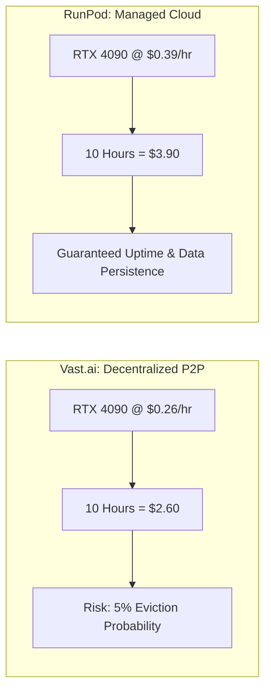

> **Direct Answer for Engineers:** **RunPod** is the better choice for **production workloads, team pipelines, and persistent model serving**, offering centralized Tier 3/4 datacenter reliability, persistent network storage, and one-click Ollama/vLLM templates. **Vast.ai** is the superior choice for **budget-conscious hobbyists, batch fine-tuning, and exploratory benchmarking**, offering the absolute lowest per-hour GPU prices in the world through its peer-to-peer spot marketplace.

If your local desktop lacks the VRAM to run massive 70-billion parameter models or if you need to fine-tune a model across multiple A100s or H100s, renting cloud GPU compute is the industry standard approach.

Two platforms dominate the low-cost cloud GPU ecosystem: **RunPod** and **Vast.ai**. While both offer high-end NVIDIA GPUs at a fraction of the cost of Amazon Web Services (AWS) or Google Cloud, their architectural philosophies are completely different.

Here is an objective, hands-on comparison across pricing, hardware reliability, storage persistence, and developer experience.

---

## The Master Comparison Matrix

| Evaluation Category | RunPod | Vast.ai | Winner |
| :--- | :--- | :--- | :--- |
| **Marketplace Architecture** | Hybrid (Datacenter + Community Cloud) | 100% Peer-to-Peer Marketplace | **RunPod (Stability)** |
| **Average RTX 4090 Spot Price** | \$0.34 – \$0.44 / hr | **\$0.22 – \$0.32 / hr** | **Vast.ai (Price)** |
| **Average A100 (80GB) Price** | \$1.69 – \$1.89 / hr | **\$1.10 – \$1.45 / hr** | **Vast.ai (Price)** |
| **Storage Persistence** | **Persistent Network Volumes (Independent)** | Tied to Host Machine | **RunPod (Data Safety)** |
| **One-Click LLM Templates** | **Yes (vLLM, Ollama, ComfyUI, TGI)** | Basic Docker search | **RunPod (Ease of Use)** |
| **Network Reliability** | High (Fiber Datacenter Uplinks) | Variable (Depends on Host ISP) | **RunPod (Network)** |
| **Interconnect Speed** | High (NVLink available) | Variable (Many PCIe 3.0/4.0 hosts) | **RunPod (Speed)** |
| **Best For** | Daily development, API servers, teams | Overnight fine-tuning, batch renders | **Context Dependent** |

[SCREENSHOT: Side-by-side dashboard screenshots of RunPod Pod Creator and Vast.ai Instance Filter showing pricing sliders]

To compare against other cloud providers like Lambda Labs and Modal, check our comprehensive ranking of the [best cloud GPU providers in 2026](https://nadhebe.com/reviews/best-cloud-gpu-providers-2026/).

---

## 1. Pricing Structure: The Cost of Decentralization

The primary attraction of Vast.ai is its unmatched price-per-hour.

Because Vast.ai operates as an open marketplace where data centers, crypto mining farms, and individual server owners list idle hardware, pricing fluctuates in real-time based on supply and demand.

### The Real Cost of a 10-Hour 70B Parameter Fine-Tuning Run

- On **Vast.ai**, you can frequently snag an RTX 4090 for **\$0.24 per hour**.
- On **RunPod**, the equivalent community cloud instance costs **\$0.39 per hour**, while a secure datacenter instance costs **\$0.44 per hour**.

However, on Vast.ai, that lower price comes with risk: if your instance is on an **interruptible bid**, a higher bidder can terminate your machine mid-training, wiping unsaved checkpoints unless you write them to external S3 storage.

---

## 2. Storage Persistence: The Critical Differentiator

When working with Large Language Models, model weights are massive:
- Llama 3.3 70B (Q4): ~40 GB
- DeepSeek-V3 / R1 (GGUF): ~45 GB – 150 GB

Downloading 50GB of weights over a residential internet connection on a cheap Vast.ai host can take 45 minutes every time you boot a container.

[SCREENSHOT: RunPod Network Storage interface showing persistent volumes attached across multiple GPU instances]

### How RunPod Wins on Storage
RunPod offers **Network Volumes** that exist independently of your compute pods. You can download your models once to a 100GB volume (\$0.07/GB/month). Whenever you want to run an experiment, you spin up a GPU pod, attach your volume, and boot in **under 20 seconds** with all weights immediately accessible in `/workspace`.

### How Vast.ai Handles Storage
On Vast.ai, your storage is physically bound to the host machine's local NVMe drive. If you stop the instance, you must continue paying the host's hourly disk rate to preserve the container. If the host shuts down their rig, your data is lost.

---

## 3. Developer Experience: Setup and Tooling

### RunPod One-Click Templates
RunPod provides official, community-verified Docker templates:
- **vLLM Engine:** Pre-configured with OpenAI-compatible API endpoints.
- **Ollama Desktop:** Ready to run with web UI and SSH access.
- **ComfyUI / Stable Diffusion:** Pre-loaded with CUDA acceleration and custom nodes.

### Vast.ai Search Filters
Vast.ai offers granular search filtering (PCIe bandwidth, disk write speed, geographic country, reliability score), but setting up environments requires comfortable knowledge of Docker CLI commands, port mapping, and SSH key management.

---

## The Final Recommendation

- **Choose RunPod if:** You are deploying a continuous API endpoint, building agentic applications, working with a team, or want to launch pre-configured models without configuring Docker ports from scratch.
- **Choose Vast.ai if:** You are running long, non-critical batch training jobs, fine-tuning LoRAs on a budget, or need raw compute power at the absolute lowest cost per hour in the industry.

Both platforms democratize AI development, giving individual engineers the compute power of a private supercomputer for less than the price of a cup of coffee.

