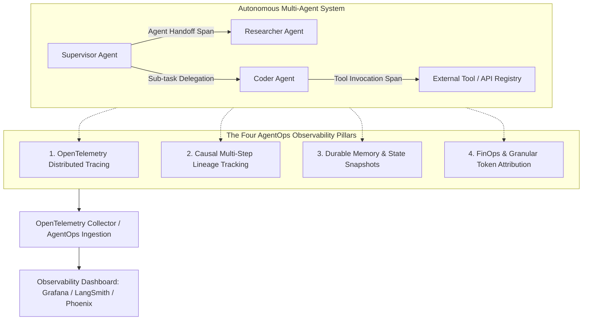

Deploying autonomous agents beyond initial prototypes introduces unprecedented operational challenges. In multi-agent systems where specialized agents collaborate, delegate, and execute tool calls asynchronously, failure modes are rarely caught by conventional HTTP status codes. An agent team can consume tens of thousands of tokens while caught in an infinite handoff deadlock, completely invisible to standard Application Performance Monitoring (APM) tools.

**AgentOps** establishes the architectural framework required to operate autonomous multi-agent networks reliably at scale. By combining OpenTelemetry-native distributed tracing, state checkpointing, and dynamic policy interception, engineering teams can debug cascading hallucinations, monitor real-time token spend, and enforce strict execution guardrails.

---

## Why Multi-Agent Systems Break in Production

Unlike single-turn LLM pipelines, multi-agent frameworks (such as LangGraph, CrewAI, AutoGen, and custom Python actor loops) exhibit non-deterministic, long-running, and emergent behaviors. A minor deviation in one agent's reasoning can cascade into catastrophic system failure downstream.

```
Common Multi-Agent Production Failure Modes:
1. Delegation Deadlocks: Agent A hands a task to Agent B, which fails to parse the context and delegates it back to Agent A, creating an infinite token-burning loop.
2. Cascading Hallucination: A researcher agent hallucinate a non-existent API parameter, which an executor agent attempts to call repeatedly until hitting hard rate limits.
3. State Drift and Desynchronization: When multiple worker agents modify a shared workspace without strict concurrency locks, race conditions corrupt the shared memory state.
4. Opaque Decision Paths: When an agent executes a destructive terminal command or database drop, traditional logs record the execution but fail to capture the reasoning prompt that triggered it.
```

---

## The Four Pillars of Multi-Agent Observability

To maintain operational visibility, a production AgentOps stack must capture telemetry across four core operational dimensions.



### 1. OpenTelemetry-Native Distributed Tracing

Agent workflows must map into standard OpenTelemetry (OTel) hierarchical spans. Each user prompt initiates a root trace. Every sub-agent delegation forms a child span, and individual model inferences and tool executions form nested leaf spans. Propagating W3C Trace Context headers across async agent boundaries preserves the causal execution tree.

### 2. Causal Multi-Step Lineage Tracking

Traditional logs record isolated timestamps. Causal lineage tracking links the input prompt, system context, intermediate reasoning tokens (`<thinking>` tags), tool arguments, tool stdout/stderr, and resulting state mutations into a continuous directed graph.

### 3. Durable Memory and State Snapshots

Observability must capture point-in-time snapshots of the agent's memory store (vector context, SQLite state, or Redis scratchpad). When a crash occurs, engineers can inspect the exact memory state of the agent prior to the failure turn.

### 4. FinOps and Granular Cost Attribution

Production systems must attribute compute and API costs at the agent, task, and tenant level. Tracking input, output, and cached prompt tokens per node allows teams to identify which specific agent in a multi-agent crew is consuming the bulk of the infrastructure budget.

---

## Production Debugging Capabilities

Observing failures is only half the battle; resolving them in high-throughput environments requires specialized operational workflows.

```mermaid
sequenceDiagram
    autonumber
    participant Client as User / Webhook
    participant Orchestrator as Multi-Agent Orchestrator
    participant Planner as Planning Agent
    participant Coder as Coding Agent
    participant Sentry as AgentOps Interceptor

    Client->>Orchestrator: "Refactor database migrations"
    Orchestrator->>Planner: Formulate task plan (Span ID: 001)
    Planner-->>Orchestrator: Plan: [Step 1: Inspect schema, Step 2: Write migration]
    Orchestrator->>Coder: Execute Step 1 (Span ID: 002)
    Coder->>Sentry: Tool Call Request: `drop table users;`
    Note over Sentry: Policy Interception: Destructive Command Detected
    Sentry-->>Coder: 403 Forbidden: Destructive schema changes blocked by policy
    Sentry->>Orchestrator: Emit Security Alert & Halt Execution Chain
    Orchestrator-->>Client: Request terminated safely via AgentOps guardrail
```

### Time-Travel Debugging and Session Replay

When an agent derails during step 14 of an automated refactoring task, debugging by re-running the entire sequence from step 1 is both expensive and non-deterministic. **Time-travel debugging** restores the agent's exact state from step 13, injects a modified instruction or corrected mock tool response, and re-executes only the failed step.

### Automated Circuit Breakers

To guard against runaway cost spikes caused by logic loops, implement runtime circuit breakers that track execution metrics against pre-set safety thresholds:

* **Maximum Turn Limit**: Terminate if an agent executes more than 15 consecutive turns without yielding a user response.
* **Repetitive Tool Call Detection**: Trigger an emergency halt if the same tool is invoked with identical parameters 3 times consecutively.
* **Budget Ceilings**: Abort the execution chain if any single session incurs more than \$2.50 in cumulative API spend.

---

## Implementing OpenTelemetry Tracing in Python

The following implementation demonstrates how to instrument an agent loop using standard OpenTelemetry spans with custom semantic attributes for LLM operations.

```python
import time
from typing import Any, Callable, Dict
from opentelemetry import trace
from opentelemetry.trace import Status, StatusCode

tracer = trace.get_tracer("agentops.multi_agent", "1.0.0")

def trace_agent_step(agent_name: str, task_type: str):
    """Decorator to capture agent reasoning and tool execution as an OpenTelemetry span."""
    def decorator(func: Callable):
        def wrapper(*args, **kwargs):
            span_name = f"agent.{agent_name}.{task_type}"
            with tracer.start_as_current_span(span_name) as span:
                span.set_attribute("gen_ai.agent.name", agent_name)
                span.set_attribute("gen_ai.task.type", task_type)
                start_time = time.time()
                
                try:
                    # Execute the underlying agent step
                    result = func(*args, **kwargs)
                    
                    # Capture token usage and latency metrics
                    duration_ms = (time.time() - start_time) * 1000
                    span.set_attribute("gen_ai.duration_ms", duration_ms)
                    span.set_attribute("gen_ai.status", "success")
                    span.set_status(Status(StatusCode.OK))
                    return result
                    
                except Exception as exc:
                    span.record_exception(exc)
                    span.set_status(Status(StatusCode.ERROR, str(exc)))
                    span.set_attribute("gen_ai.status", "failed")
                    raise exc
        return wrapper
    return decorator

# Example Usage within a Multi-Agent Loop
class ProductionAgent:
    def __init__(self, name: str):
        self.name = name

    @trace_agent_step(agent_name="ResearchWorker", task_type="information_retrieval")
    def retrieve_context(self, query: str) -> Dict[str, Any]:
        # Simulating external tool execution and vector lookup
        span = trace.get_current_span()
        span.set_attribute("gen_ai.tool.name", "vector_search")
        span.set_attribute("gen_ai.prompt.tokens", 420)
        span.set_attribute("gen_ai.completion.tokens", 85)
        
        return {"query": query, "documents_found": 4, "status": "resolved"}
```

---

## Tooling Landscape Comparison

Choosing the right observability platform depends on whether your team prioritizes open-source standards or managed out-of-the-box dashboards.

| Platform / Tool | Open Source? | Multi-Agent Specialization | Protocol Support | Core Strengths |
| :--- | :--- | :--- | :--- | :--- |
| **AgentOps** | Freemium SaaS | Native | REST / Custom SDK | Session replay, handoff deadlocks, cost budgeting |
| **LangSmith** | Closed SaaS | Deep (LangGraph Native) | Custom Client / OTel | Unmatched trace visualization for LangGraph workflows |
| **Arize Phoenix** | Yes (Apache 2.0) | High | OpenTelemetry Native | Self-hostable, zero vendor lock-in, RAG evaluation |
| **Grafana + Tempo** | Yes (OSS / Cloud) | General Purpose APM | OpenTelemetry Native | Enterprise-wide unified logs, metrics, and traces |
| **Future AGI (traceAI)** | SaaS | High | REST / Python SDK | Multi-framework support (CrewAI + LangChain + Custom) |

---

## Best Practices for Operating Agents in Production

1. **Enforce W3C Trace Context Propagation**: Always inject `traceparent` headers when an agent initiates a background worker task, triggers a message queue payload, or calls an external webhook.
2. **Never Log Raw Unredacted Prompts in Unsecured Stores**: LLM inputs often contain Personally Identifiable Information (PII) or internal credentials. Deploy an automated PII anonymization filter before writing traces to storage.
3. **Establish Alerting SLAs on Agent Latency**: Set alerts based on percentiles ($p95 > 8\text{s}$) rather than averages, as agent loops with multiple tool retries exhibit long-tail latency distributions.
4. **Decouple Telemetry Ingestion from Inference Workers**: Never let a slow observability collector block the agent runtime. Transmit OpenTelemetry spans asynchronously via background threads or local sidecar forwarders.

---

## Production AgentOps Checklist

- [ ] Every agent node and tool execution instruments an OpenTelemetry span with standardized GenAI attributes.
- [ ] Correlation IDs (`session_id`, `trace_id`, `agent_id`) are propagated across all async message brokers.
- [ ] Circuit breakers are active to catch infinite handoff loops and repetitive tool calls.
- [ ] Hard token and monetary cost ceilings are configured per task and per tenant.
- [ ] PII redaction and secret scanning are enforced on prompt inputs before telemetry storage.
- [ ] Alerting rules are active for abnormal error rates, token spikes, and latency regressions.

AgentOps is not an optional operational add-on; it is the fundamental reliability infrastructure that transforms unstable multi-agent prototypes into production-grade enterprise software.

