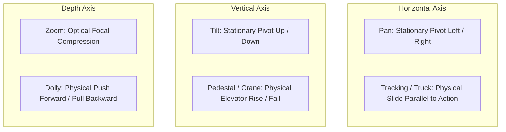

> **Direct Answer for Directors:** To control camera movement in **Google Flow and Google Veo**, define a single clear **Motion Vector** at the beginning of each prompt using standard ASC terminology (e.g., `Dolly In`, `Tracking Left`, `Crane Up`, `Slow Pan Right`). For seamless cross-shot transitions, enforce **Vector Continuity** by aligning the exit trajectory of Shot A with the entry trajectory of Shot B, or execute a **Match Cut** on a shared visual shape or action beat.

In filmmaking, the camera is never a passive observer; its movement tells the audience where to look, what to feel, and how characters relate to their environment. However, generative video models do not possess physical tripod heads, dollies, or cranes. They synthesize camera movement by predicting optical flow and perspective transformation across successive latent frames.

If your prompt is vague, the model defaults to disorienting zooms, warping walls, and unnatural perspective shifts.

This guide details the exact camera movement vocabulary and cross-shot transition techniques required to build fluid, professional cinematic sequences in Google Flow.

---

## 1. The Core Camera Movement Vectors

When prompting camera movement in Google Flow Storyboard Studio, choose one primary axis of motion per 4-second clip.



[SCREENSHOT: Diagram illustrating the physical difference between Pan vs Tracking, and Tilt vs Crane Pedestal]

---

## 2. Tested Prompt Formulations for Each Rig

### 1. The Dolly Push-In (Building Psychological Intimacy)
A dolly physically moves toward the subject, creating natural depth parallax.
```text
Slow, creeping cinematic dolly push-in toward protagonist's face. Camera glides forward smoothly on heavy steel tracks at eye level, 50mm lens. The background shelves gradually expand into creamy soft-focus bokeh while subject remains tack-sharp. Quiet dramatic tension.
```

### 2. The Tracking Shot (Momentum & Pacing)
A tracking (or trucking) shot runs parallel alongside characters as they move.
```text
Smooth sideways tracking shot moving parallel to a runner sprinting down an urban sidewalk. Camera maintains a constant 10-foot distance, traveling at matching speed. 35mm lens, dynamic background motion blur on storefront windows, natural handheld stabilization.
```

### 3. The Crane / Jib Pedestal (Epic Scale & Discovery)
A crane moves vertically on the Y-axis to reveal hidden landscape or spatial context.
```text
Dramatic high crane shot starting low behind a stone wall, slowly booming upward into the air to reveal a vast medieval army assembled across the green valley below. 24mm wide-angle lens, sweeping vertical motion, cinematic dawn lighting breaking over the ridgeline.
```

### 4. The 180-Degree Circular Arc (The Hero Standoff)
The camera orbits around characters to emphasize a pivotal turning point.
```text
Smooth 180-degree circular orbital camera arc revolving around two duelists standing back-to-back in an ancient courtyard. Eye-level perspective, 40mm anamorphic lens, steady continuous orbital rotation, fallen cherry blossom petals swirling across the foreground.
```

---

## 3. Designing Invisible Cross-Shot Transitions

Professional editors cut on motion. When scenes feel clunky in AI video, it is usually because the camera stopped abruptly before the cut.

[SCREENSHOT: Storyboard timeline illustrating the Vector Continuity Match Cut between two consecutive clips]

### Technique 1: The Directional Motion Whip
- **Shot 01 (Outgoing):** End the shot with a rapid camera sweep to screen right.
  ```text
  ...camera suddenly whips rapidly to screen right, blurring background into heavy directional motion streaks.
  ```
- **Shot 02 (Incoming):** Begin the shot with the same rightward momentum settling onto the new location.
  ```text
  Camera enters shot on a fast whip-pan from screen left, decelerating to a halt to reveal the interior of a luxury penthouse...
  ```

### Technique 2: The Push-Through Match Cut
- **Shot 01:** Dolly aggressively into a dark opening or silhouette (e.g., an actor's pupil, a tunnel entrance, or a keyhole) until the frame goes black.
- **Shot 02:** Push out from deep darkness into a brightly lit new environment with identical center-weighted composition.

### Technique 3: The Match-on-Action
- **Shot 01 (Medium Shot):** Protagonist kicks open a heavy wooden door. The door swings forward.
- **Shot 02 (Reverse Angle / Interior):** The wooden door violently crashes open toward the camera as the protagonist steps through. The continuity of velocity creates a seamless visual cut.
- Ensure your character's clothing and facial features remain identical across the transition by applying our [character consistency formula](https://nadhebe.com/tutorials/how-to-keep-characters-consistent-in-google-flow/).

---

## 4. Troubleshooting Common Camera Glitches in Veo

| Common Camera Issue | Underlying Cause | Prompt & Setting Fix |
| :--- | :--- | :--- |
| **"Funhouse Mirror" Warping** | Lens set too wide (< 16mm) during rapid rotation | Increase focal length to 35mm or 50mm |
| **Micro-Jitter & Shaking** | Vague motion tags like "handheld action" | Change prompt to "Steadicam stabilized fluid movement" |
| **Camera Drifting Away** | Lack of a focal anchor point | Explicitly tag: "Camera strictly tracks subject's torso" |
| **Perspective Squishing** | Confusing zoom with dolly movement | Use "physical dolly track push" instead of "zoom in" |

---

## The Director's Cinematography Cheat Sheet

Keep these camera tags at your fingertips when directing shots in Google Flow:

```text
-- CAMERA MOVEMENT VOCABULARY --
• [DOLLY IN / OUT]: Physical linear movement forward or backward.
• [TRUCK LEFT / RIGHT]: Physical linear movement sideways.
• [PEDESTAL UP / DOWN]: Physical vertical elevator movement.
• [PAN LEFT / RIGHT]: Horizontal stationary axis rotation.
• [TILT UP / DOWN]: Vertical stationary axis rotation.
• [ROLL / CANT]: Rotating the camera along the lens axis (Dutch angle).
• [ARC SHOT]: Orbiting horizontally in a radius around the subject.
• [WHIP PAN]: High-velocity pan creating directional motion blur.
```

By commanding specific physical camera rigs and designing intentional motion vectors across shot boundaries, your Google Flow projects will possess the fluid, dynamic visual grammar of master cinema.

