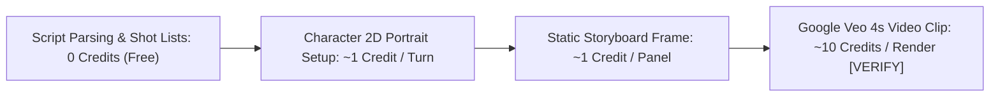

> **Direct Answer for Creators:** **Google Flow Storyboard Studio** is currently available as an experimental Google Labs release with **free daily rolling credit quotas** for eligible accounts. Text-based screenplay parsing and shot list organization do not consume video credits, while generating static storyboard panels costs ~1 credit and synthesizing a 4-second **Google Veo video clip costs ~10 compute credits** [VERIFY]. Commercial and enterprise production teams scaling beyond daily experimental caps can access the underlying Veo video models through **Google Cloud Vertex AI** on a per-second billing model.

Budgeting for AI video production can be opaque. Unlike traditional software subscriptions with flat monthly fees, generative video platforms meter usage based on GPU inference time, token length, resolution, and temporal frame counts.

If you are planning a commercial previz deck or an independent film production using Google Flow, understanding how credits are consumed, how rate limits operate, and how to avoid wasting generation tokens is essential.

Here is the complete breakdown of Google Flow pricing, credit consumption, and quota optimization strategies.

---

## 1. Google Flow Account Tiers: Free Labs vs. Vertex AI Enterprise

Google distributes access to Flow and Veo through two distinct infrastructure channels:

[SCREENSHOT: Account settings panel showing current daily credit balance, quota countdown timer, and subscription tier status]

### Tier Comparison Overview

| Feature / Metric | Google Labs Experimental Tier | Google Cloud Vertex AI (Enterprise) |
| :--- | :--- | :--- |
| **Primary Audience** | Indie creators, directors, previz artists | Studios, creative agencies, enterprise SaaS |
| **Access Requirements** | Standard Google Account / Labs Waitlist | Google Cloud Platform (GCP) Billing Account |
| **Base Cost** | Free with rolling daily credit cap [VERIFY] | Pay-as-you-go per second of generated video |
| **Storyboard Studio UI** | Full interactive visual deck interface | API endpoints / Custom developer pipelines |
| **Veo Video Duration** | Standard 4.0-second clips | Up to 60-second stitched sequences via API |
| **Resolution** | 720p / 1080p Previz Quality | 1080p / 4K UHD Master Quality |
| **Commercial Usage** | Personal, educational, and pre-production pitch | Full commercial distribution rights |

---

## 2. How Credits Are Consumed in Storyboard Studio

Inside the Google Flow interface, actions consume different amounts of compute resources based on whether they require text parsing, 2D image diffusion, or full spatio-temporal video synthesis.

### 1. Script Parsing & Shot List Organization (0 Credits)
Importing scripts, reordering panels, writing scene descriptions, and exporting PDF director's binders consume zero video generation credits. You can adjust your narrative structure indefinitely without burning quota.

### 2. Character Setup & Reference Generation (~1 Credit)
Generating initial 2D portrait turnaround sheets in Step 2 uses standard diffusion tokens, consuming roughly 1 credit per image generation turn [VERIFY].

### 3. Static Panel Diffusion (~1 Credit per Panel)
When you render a static visual panel in Step 3 to review camera framing and character blocking, it consumes approximately 1 credit.

### 4. Google Veo Video Generation (~10 Credits per 4s Clip)
Animating an approved static panel into a 4-second motion video sequence is compute-intensive, requiring distributed Cloud TPU inference. Each 4-second clip deducts approximately 10 credits from your balance [VERIFY].

---

## 3. Rate Limits, Concurrency, and Queue Throttling

Beyond raw credit totals, Google Flow enforces strict concurrency rules to prevent server overload:

- **Concurrent Generation Limit:** Most accounts are limited to **2 simultaneous video renders** at a time. If you click "Generate Video" across an entire 10-shot scene, the first two will process while the remaining eight queue sequentially.
- **Hourly Burst Throttling:** Submitting more than 15 generation requests in a 10-minute window will trigger a temporary 5-minute cooldown timer (*"Service busy, please retry in a few moments"*).
- **Daily Quota Reset Window:** Daily credit allowances reset automatically every 24 hours at **00:00 UTC**. Unused credits do not roll over to the following day.
- If you find your renders stalling or failing near quota boundaries, check our diagnostic checklist on [Google Flow generation failures and stuck renders](https://nadhebe.com/tutorials/google-flow-storyboard-studio-not-working/).

---

## 4. Five Practical Rules to Save Credits on Every Project

In commercial pre-production, burning through your daily quota in the first hour halts work for the rest of the day. Apply these professional cost-saving habits:

[SCREENSHOT: Storyboard timeline showing static panel thumbnails with selective video render badges]

### Rule 1: Never Render Video on Draft Framing
Do not trigger a 10-credit Veo video generation until you have thoroughly reviewed the 1-credit static storyboard panel. Verify that the character's face, costume, and lighting match your vision before animating.

### Rule 2: Finalize Script Syntax Locally First
Fix all grammar, scene sluglines, and character tags in a plain text editor before importing into Google Flow. Frequent re-imports force you to re-generate character asset binders and test panels unnecessarily.

### Rule 3: Use Static Panels for Dialogue Sequences
In standard narrative film, conversations often feature static shots with minimal motion. Only animate panels where camera movement (dolly, crane, tracking) or kinetic action adds genuine storytelling value. A 10-shot scene with 4 animated clips and 6 static frames communicates the exact same vision while saving 60 credits.

### Rule 4: Lock Seeds on Satisfactory Compositions
When you find a panel composition that works, copy and lock the **Seed Number** in panel settings. If you need to re-prompt slightly to adjust a prop or hair stray, locking the seed prevents the model from generating an entirely different room layout.

### Rule 5: Compare Third-Party Cloud GPU Infrastructure
If your production requires generating hundreds of hours of raw video, self-hosting open-source diffusion models or using specialized cloud GPU providers can be significantly more economical than proprietary API tokens. Compare infrastructure options in our detailed review of the [best cloud GPU providers in 2026](https://nadhebe.com/reviews/best-cloud-gpu-providers-2026/).

---

## Summary Credit Reference Sheet

| Action / Asset Type | Estimated Credit Cost | Recommended Workflow |
| :--- | :--- | :--- |
| **Fountain Script Parsing** | **0 Credits** | Unlimited revisions |
| **Shot Re-ordering & Deletion** | **0 Credits** | Organize full sequence before rendering |
| **Character Reference Portrait** | **1 Credit** | Generate 3-view turnaround once per project |
| **Single Static Panel Frame** | **1 Credit** | Use to confirm blocking and lighting |
| **4-Second Veo Video Clip** | **~10 Credits [VERIFY]** | Reserve exclusively for final hero shots |
| **PDF Director's Binder Export** | **0 Credits** | Free printable export anytime |

Understanding your credit burn rate allows you to plan realistic production schedules, maximize your daily creative output, and deliver client-ready previz decks without running into unexpected quota barriers.

