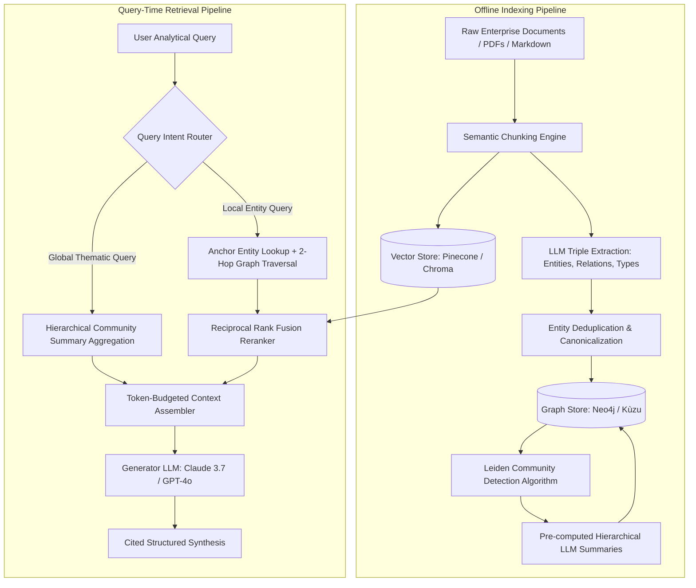
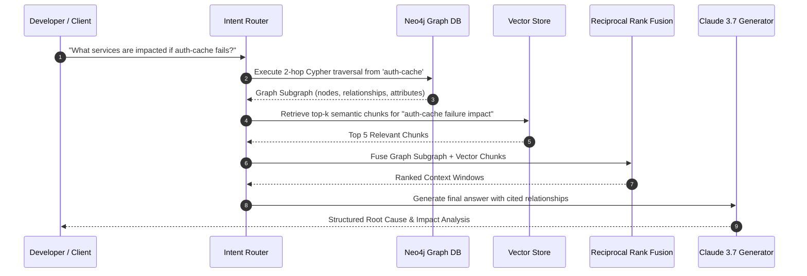

Conventional Retrieval-Augmented Generation (RAG) is hitting a structural wall. While vector search excels at retrieving isolated text chunks that closely match the phrasing of a query, it fails when an answer requires synthesizing information distributed across multiple documents or understanding relationships between disparate entities. **GraphRAG** addresses this fundamental limitation by combining high-dimensional vector embeddings with structured **Knowledge Graphs (KGs)**.

By extracting entities, relationships, and hierarchical communities from unstructured text, GraphRAG transforms disconnected text fragments into an interconnected graph topology. Systems can then perform both targeted local neighborhood traversals and global thematic aggregations, delivering context-aware synthesis for complex enterprise applications.

---

## Why Standard Vector RAG Fails at Enterprise Scale

Standard vector RAG splits documents into arbitrary token windows (e.g. 512 tokens with 50-token overlap), embeds each chunk using a dense embedding model, and indexes them in a vector database. While this approach is effective for direct keyword or semantic lookups, it introduces critical failure modes in real-world environments:

```
Standard Vector RAG Failure Modes:
1. Information Fragmentation: Concepts split across chunk boundaries lose context.
2. The "Multi-Hop" Blind Spot: Queries like "How did Supplier A's component delay impact Project B's compliance audit?" fail because the connecting entities live in separate, unlinked chunks.
3. Thematic Blindness: Broad aggregations like "What are the core engineering risks identified across all 2026 client proposals?" cannot be answered by cosine similarity over individual chunks.
```

GraphRAG solves these issues by structuring data into semantic triples `(Subject -> Predicate -> Object)` and organizing them into hierarchical community clusters.

---

## High-Level GraphRAG Architecture

A production-grade GraphRAG system is divided into two distinct operational pipelines: the **Offline Indexing Pipeline** (which extracts and structures the graph) and the **Query-Time Retrieval Pipeline** (which synthesizes answers using hybrid search).



---

## Technology Stack Selection

Building a resilient GraphRAG pipeline requires choosing appropriate graph and vector storage engines based on scale, query latency, and deployment architecture.

| Component Layer | Technology Options | Primary Strengths | Tradeoffs / Considerations |
| :--- | :--- | :--- | :--- |
| **Graph Database** | **Neo4j** | Industry standard, native Cypher, GDS library, distributed scaling | Requires dedicated JVM cluster or managed AuraDB |
| | **Kùzu** | Embedded C++ graph engine, in-process, zero-setup, Cypher support | In-process only; limited distributed clustering |
| | **NetworkX** | Pure Python, zero external dependencies, rapid local prototyping | Single-threaded memory limits; unsuitable for large corpora |
| **Vector Store** | **ChromaDB / LanceDB** | Embedded, multimodal, fast local query execution | Limited enterprise access control capabilities |
| | **Pinecone / Qdrant** | Managed, high-scale metadata filtering, hybrid search native | Cloud egress latency; external SaaS dependency |
| **Extraction Engine** | **Claude 3.7 / GPT-4o** | High reasoning fidelity, strict JSON schema output adherence | Token costs scale during initial offline extraction |
| | **vLLM + Qwen 2.5 72B** | Self-hosted, zero per-token cost, private on-premise execution | Requires dedicated GPU infrastructure |

---

## Phase 1: Entity and Relationship Extraction

The foundation of GraphRAG is the extraction of structured triples from unstructured text chunks. Rather than relying on rigid NLP regex pipelines, production systems employ LLMs configured with strict extraction prompts.

```python
import json
from typing import List
from pydantic import BaseModel, Field
from openai import OpenAI

client = OpenAI()

class ExtractedEntity(BaseModel):
    name: str = Field(description="Canonicalized entity name in lowercase")
    entity_type: str = Field(description="Category: ORGANIZATION, PERSON, SYSTEM, RISK, METRIC")
    description: str = Field(description="1-2 sentence description of the entity in this context")

class ExtractedRelationship(BaseModel):
    source_entity: str = Field(description="Subject entity name")
    target_entity: str = Field(description="Object entity name")
    relationship_type: str = Field(description="Verbal predicate: DEPENDS_ON, IMPACTS, DEPLOYS, OWNS")
    weight: float = Field(description="Relationship confidence score between 0.0 and 1.0")
    description: str = Field(description="Contextual explanation of the relationship")

class GraphExtractionPayload(BaseModel):
    entities: List[ExtractedEntity]
    relationships: List[ExtractedRelationship]

EXTRACTION_SYSTEM_PROMPT = """
You are a precision knowledge graph data engineer.
Extract all salient entities and semantic relationships from the provided document chunk.
Adhere strictly to standard entity categories and active-voice predicates.
Return exclusively valid JSON matching the requested schema.
"""

def extract_graph_elements(chunk_text: str) -> GraphExtractionPayload:
    response = client.beta.chat.completions.parse(
        model="gpt-4o",
        messages=[
            {"role": "system", "content": EXTRACTION_SYSTEM_PROMPT},
            {"role": "user", "content": f"Document Chunk:\n{chunk_text}"}
        ],
        response_format=GraphExtractionPayload,
        temperature=0.0
    )
    return response.choices[0].message.parsed
```

---

## Phase 2: Entity Resolution and Graph Database Ingestion

Raw extraction frequently yields duplicate or near-duplicate entities (e.g. `"K8s"`, `"Kubernetes"`, and `"Kubernetes Cluster"`). Before ingesting triples into a graph database, run an entity resolution pass to canonicalize names.

Once canonicalized, ingest nodes and edges into **Neo4j** using parameterized Cypher queries to ensure idempotency.

```python
from neo4j import GraphDatabase

class Neo4jGraphStore:
    def __init__(self, uri: str, auth: tuple):
        self.driver = GraphDatabase.driver(uri, auth=auth)

    def close(self):
        self.driver.close()

    def upsert_graph_payload(self, payload: GraphExtractionPayload):
        with self.driver.session() as session:
            # 1. Upsert Nodes
            for entity in payload.entities:
                session.run(
                    """
                    MERGE (e:Entity {name: $name})
                    ON CREATE SET 
                        e.type = $type,
                        e.description = $description,
                        e.created_at = timestamp()
                    ON MATCH SET 
                        e.description = e.description + ' | ' + $description
                    """,
                    name=entity.name.lower(),
                    type=entity.entity_type,
                    description=entity.description
                )

            # 2. Upsert Edges
            for rel in payload.relationships:
                session.run(
                    """
                    MATCH (source:Entity {name: $source_name})
                    MATCH (target:Entity {name: $target_name})
                    MERGE (source)-[r:RELATION {type: $rel_type}]->(target)
                    ON CREATE SET 
                        r.weight = $weight,
                        r.description = $description
                    ON MATCH SET 
                        r.weight = (r.weight + $weight) / 2.0
                    """,
                    source_name=rel.source_entity.lower(),
                    target_name=rel.target_entity.lower(),
                    rel_type=rel.relationship_type.upper(),
                    weight=rel.weight,
                    description=rel.description
                )
```

---

## Phase 3: Leiden Community Detection and Hierarchical Summaries

The innovation popularized by the **Microsoft GraphRAG** architecture is the use of graph clustering to answer corpus-wide thematic questions.

Instead of navigating thousands of individual nodes at query time, GraphRAG executes the **Leiden community detection algorithm** to identify modular partitions within the graph at multiple hierarchical levels:

```
Hierarchical Community Topology:
[Level 0: Macro Communities]
   └── Community C0-1: Infrastructure & Cloud Operations
         ├── Level 1: Sub-Community C1-1: Kubernetes Ingress Controllers
         │     ├── Node: Traefik
         │     ├── Node: NGINX Ingress
         │     └── Node: Cert-Manager
         └── Level 1: Sub-Community C1-2: Service Mesh & Security
               ├── Node: Istio
               └── Node: mTLS Policy Engine
```

For each community detected, an LLM summarizes the cluster's key entities, relationships, and overarching themes. These pre-computed summaries are stored back in the graph, providing a cached layer for global queries.

---

## Phase 4: Query-Time Hybrid Retrieval

Production queries typically fall into two categories: **Local (Entity-Centric)** and **Global (Thematic)**. A query intent classifier routes incoming requests to the appropriate retrieval engine.



### Local Search via Cypher Subgraph Traversal

When the user asks about specific entities, GraphRAG performs a 1-hop or 2-hop traversal around the anchor entity:

```cypher
// Local Neighborhood Cypher Query: 2-Hop Traversal with Relation Weighting
MATCH (start:Entity {name: $anchor_entity})
MATCH path = (start)-[r:RELATION*1..2]-(neighbor:Entity)
WHERE all(rel in relationships(path) WHERE rel.weight >= 0.5)
RETURN 
    start.name AS source,
    [rel in relationships(path) | type(rel)] AS relationship_path,
    neighbor.name AS target,
    neighbor.description AS target_description
LIMIT 25;
```

### Global Search via Community Summaries

For broad questions (e.g. *"What are the primary operational risks across our microservices?"*), GraphRAG skips entity traversal and queries the pre-computed community summaries directly:

```cypher
MATCH (c:CommunitySummary)
WHERE c.level = 0
RETURN c.community_id, c.summary_text, c.rating_impact
ORDER BY c.rating_impact DESC;
```

---

## Context Assembly and Reciprocal Rank Fusion (RRF)

To maximize factual grounding, fuse structured graph facts with unstructured vector snippets using **Reciprocal Rank Fusion (RRF)**:

$$\text{RRF\_Score}(d) = \sum_{m \in M} \frac{1}{k + r_m(d)}$$

Where $M$ is the set of retrieval models (Graph Cypher vs Vector DB), $r_m(d)$ is the document rank in model $m$, and $k$ is a smoothing constant (typically $k=60$).

```python
def reciprocal_rank_fusion(vector_results: list, graph_results: list, k: int = 60) -> list:
    scores = {}
    
    # Process vector rankings
    for rank, item in enumerate(vector_results, 1):
        item_id = item['id']
        scores[item_id] = scores.get(item_id, 0.0) + (1.0 / (k + rank))
        
    # Process graph entity rankings
    for rank, item in enumerate(graph_results, 1):
        item_id = item['id']
        scores[item_id] = scores.get(item_id, 0.0) + (1.0 / (k + rank))
        
    # Sort merged results by fused score
    sorted_items = sorted(scores.items(), key=lambda x: x[1], reverse=True)
    return sorted_items
```

---

## Architectural Comparison: Standard RAG vs GraphRAG vs Hybrid RAG

| Evaluation Metric | Standard Vector RAG | Microsoft GraphRAG | Production Hybrid RAG |
| :--- | :--- | :--- | :--- |
| **Index Complexity** | Low (Single-pass embedding) | High (Multi-stage extraction + Leiden clustering) | Medium-High (Selective entity extraction + vectors) |
| **Indexing Token Cost** | Low (\$0.02 - \$0.10 / MB) | High (\$1.50 - \$4.00 / MB) | Moderate (\$0.40 - \$0.80 / MB) |
| **Multi-Hop Reasoning** | Poor (Fails across chunk boundaries) | Outstanding (Deterministic graph walks) | Outstanding (Graph traversal + semantic context) |
| **Thematic Queries** | Fails (Cosine similarity blind spot) | Native (Hierarchical community summaries) | Native (Community summaries + vector reranking) |
| **Retrieval Latency** | Fast (15ms - 50ms) | Moderate-Slow (200ms - 800ms) | Fast-Moderate (80ms - 250ms) |
| **Hallucination Rate** | Moderate (12% - 18%) | Extremely Low (< 3%) | Extremely Low (< 2%) |

---

## Evaluation Metrics: Measuring GraphRAG with RAGAS

Evaluate your GraphRAG implementation using structural and multi-hop metrics rather than standard text similarity:

1. **Entity Recall**: Measures the percentage of ground-truth entities present in the assembled context window relative to total entities required.
2. **Multi-Hop Path Coverage**: Verifies whether the traversal followed the valid causal dependency chain ($A \rightarrow B \rightarrow C$) required to establish truth.
3. **Contextual Groundedness**: The ratio of generated answer sentences directly backed by graph triples or vector chunk citations.

---

## Production Best Practices

* **Bound Cypher Traversal Depths**: Never run unbounded variable-length graph queries (`[*1..]`). Always enforce depth boundaries (`[*1..2]`) and result limits (`LIMIT 25`) to prevent memory exhaustion on dense subgraphs.
* **Cache Triple Extractions**: Store the extracted JSON payload for each document chunk hash in a key-value store (e.g. Redis). If a document doesn't change, skip the extraction step entirely.
* **Filter Edge Weights**: Prune low-confidence relationships ($< 0.4$) during ingestion to prevent graph clutter and maintain traversal relevance.
* **Monitor Token Budgets**: Global search across multiple community summaries can consume significant context window space. Compress community summaries into concise bullet points before final synthesis.

---

## Summary Implementation Checklist

- [ ] Chunking pipeline configured with entity-preserving semantic boundaries.
- [ ] LLM extraction engine bound to strict JSON schema validation for entities and relations.
- [ ] Entity resolution step applied to merge synonyms and aliases before graph ingestion.
- [ ] Neo4j or Kùzu database provisioned with unique constraints on `Entity(name)`.
- [ ] Parameterized Cypher queries configured for idempotent node and edge merges.
- [ ] Leiden community detection executed and hierarchical summaries stored in graph.
- [ ] Query intent classifier implemented to route requests to local or global search.
- [ ] Reciprocal Rank Fusion configured to merge vector snippets with graph traversals.

GraphRAG bridges the gap between semantic intuition and structured truth, providing the architectural foundation for reliable, enterprise-grade AI reasoning.

