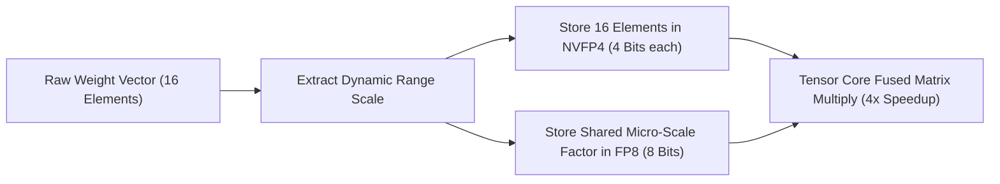
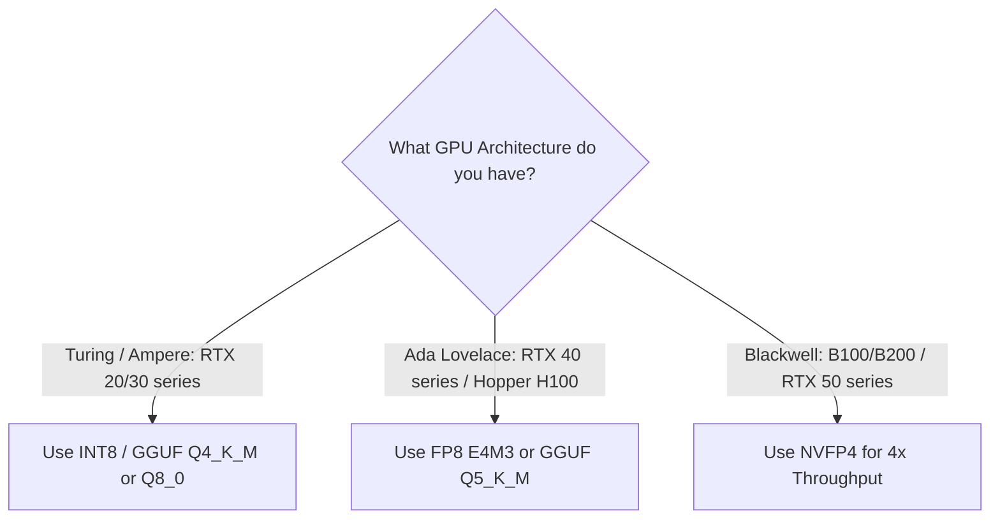

> **Direct Answer for Engineers:** **FP8** is currently the best general-purpose quantization format for modern GPUs (NVIDIA Ada Lovelace RTX 40-series and Hopper H100), delivering **50% memory savings with virtually zero perplexity degradation**. **INT8** is a legacy integer format best suited for older hardware lacking native floating-point Tensor Cores. **NVFP4** is NVIDIA's groundbreaking 4-bit floating-point format engineered for Blackwell architectures (B200, RTX 50-series), providing a **4x memory reduction and doubling token throughput** compared to FP16.

Quantization is the single most effective lever for reducing the cost and latency of Large Language Model inference. By converting high-precision 16-bit floating-point weights (`FP16`/`BF16`) into compact 8-bit or 4-bit representations, developers can run larger, more intelligent models on consumer hardware and double the concurrent throughput of cloud GPU clusters.

However, the proliferation of competing numerical formats—**INT8, FP8 (E4M3/E5M2), and NVFP4**—has created widespread confusion about which format to choose for a specific GPU generation.

Here is an architectural comparison of all three formats, their hardware requirements, and when to use each in production.

---

## 1. Number Representation: Understanding the Bits

To understand why these formats perform differently, examine how each assigns its bits:

```
[FP16 Standard: 16 Bits]
1 Sign Bit | 5 Exponent Bits (Dynamic Range) | 10 Mantissa Bits (Precision)

[FP8 (E4M3): 8 Bits]
1 Sign Bit | 4 Exponent Bits | 3 Mantissa Bits (Optimized for Weights & Forward Inference)

[INT8: 8 Bits]
1 Sign Bit | 7 Integer Magnitude Bits (Fixed Linear Step Size)

[NVFP4: 4 Bits + Micro-Scaling Block]
1 Sign Bit | 2 Exponent Bits | 1 Mantissa Bit + Shared FP8 Scaling Factor per 16 Elements
```

[SCREENSHOT: Diagram comparing the numerical dynamic range distribution of FP8 floating point vs INT8 uniform integer grids]

Check how these formats impact your specific graphics card using our [GPU VRAM Calculator](https://nadhebe.com/tools/gpu-vram-calculator/).

### The "Outlier Activation" Problem: Why FP8 Defeated INT8
Large language models naturally develop "outlier features"—rare activation values that are 20x to 100x larger than average weights. 
- In **INT8**, uniform linear quantization forces these massive outliers to clip or squishes the remaining 99.9% of normal weights into tiny rounding buckets, resulting in noticeable perplexity degradation.
- In **FP8**, the logarithmic exponent bits naturally capture both tiny gradient values and massive outlier spikes, preserving reasoning accuracy without manual outlier separation techniques like SmoothQuant.

For an in-depth mathematical comparison with earlier quantization schemes, read our guide on [FP4 vs FP8 vs INT4 quantization](https://nadhebe.com/guides/fp4-vs-fp8-vs-int4-quantization).

---

## 2. Head-to-Head Architecture Comparison

| Evaluation Metric | INT8 (Integer) | FP8 (E4M3 / E5M2) | NVFP4 (NVIDIA Micro-Scaled) |
| :--- | :--- | :--- | :--- |
| **Bits per Parameter** | 8 Bits (1 Byte) | 8 Bits (1 Byte) | 4 Bits (0.5 Bytes) |
| **Memory Reduction vs FP16** | **2x (50% Savings)** | **2x (50% Savings)** | **4x (75% Savings)** |
| **Perplexity Degradation** | Moderate (< 1.5% loss) | Near-Zero (< 0.2% loss) | Minimal (< 0.8% loss) |
| **Outlier Handling** | Poor (Requires clipping) | Exceptional (Floating-point exponent) | Exceptional (Micro-scaled blocks) |
| **Native Hardware Support** | Turing (RTX 20), Ampere (RTX 30) | Ada (RTX 40), Hopper (H100) | Blackwell (B100/B200, RTX 50) |
| **Primary Production Role** | Legacy CPU / older GPU inference | Current production standard | Next-generation frontier serving |

---

## 3. NVFP4: How NVIDIA Made 4-Bit Inference Lossless

Historically, pushing models down to 4-bit precision resulted in catastrophic degradation in complex multi-step reasoning, coding, and mathematical benchmarks.

NVIDIA solved this on the **Blackwell architecture** by introducing **Micro-Scaled FP4 (NVFP4)**:



Rather than applying a single quantization scale across an entire tensor layer, NVFP4 applies micro-scaling factors across tiny blocks of 16 elements. This allows the model to compress weights to 4 bits while dynamically preserving local dynamic range.

A 70-billion parameter model like Llama 3.3 70B:
- **Uncompressed FP16:** ~140 GB VRAM (Requires two 80GB H100s)
- **NVFP4:** ~38 GB VRAM (Fits easily onto a single consumer RTX card or single PCIe GPU)

---

## 4. Decision Matrix: Which Quantization Should You Pick?



- **If you are running an RTX 3060, 3080, or 3090:** Use **GGUF Q4_K_M or Q5_K_M** via llama.cpp or Ollama. Your GPU lacks native FP8 Tensor Cores, so GGUF integer kernel optimizations yield the best performance. Learn more in our [Ollama quantization formats comparison](https://nadhebe.com/guides/ollama-quantization-formats-compared).
- **If you are serving models on RTX 4080/4090 or cloud H100s:** Choose **FP8 (vLLM / TensorRT-LLM)**. It cuts your VRAM demands in half and doubles batch throughput with zero code modifications.
- **If you have access to NVIDIA Blackwell infrastructure:** Deploy **NVFP4**. It enables running 70B parameter models at speeds previously only achievable with 8B models.

Quantization is no longer a compromise—it is the foundational architecture of scalable AI inference.

