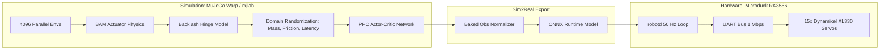

Bipedal walking has historically represented one of the most stubborn friction points in physical robotics. Traditional control frameworks—such as Zero-Moment Point (ZMP) computation, Linear Inverted Pendulum Models (LIPM), and Model Predictive Control (MPC)—demand high-precision joint encoders, rigid links, low-backlash harmonic drives, and millisecond-level solver iterations. In sub-kilogram desktop robots built with commodity hobby servos, backlash, gear compliance, and thermal variance render analytical kinematic models brittle.

**Microduck**, engineered by French robotics laboratory **Pollen Robotics** (famed for their open-source Reachy humanoid), represents a radical architectural departure. Standing 25 cm tall and weighing approximately 800 grams, Microduck eschews classical analytical control loops. Its locomotion, fall recovery, balance correction, and expressive head gestures are governed entirely by **reinforcement learning (RL) neural policies** evaluated at 50 Hz onboard a low-power Rockchip RK3566 processor.

In this deep dive, we dissect the actual, verified engineering of Microduck based on Pollen Robotics' official product documentation and public GitHub repositories (`pollen-robotics/microduck` and `pollen-robotics/microduck_rl`). We explore its 15-servo physical anatomy, its 7-daemon Rust operating architecture, its 61-dimensional observation contract, and the sim2real physics model that allows policies trained in GPU-accelerated MuJoCo to transfer seamlessly onto physical plastic and metal.

---

## Microduck System Architecture & Kinematic Chain

Below is the verified mechanical joint layout and daemon communication architecture powering the Microduck biped:

```text
                     [HEAD / SENSORY MAST]
                 ┌───────────────────────────┐
                 │ • VL53L5CX 8x8 ToF Sensor │
                 │ • 640x480 CMOS RGB Camera │
                 │ • Neck Pitch (XL330 Servo)│
                 │ • Head Pitch (XL330 Servo)│
                 │ • Head Yaw   (XL330 Servo)│
                 │ • Head Roll  (XL330 Servo)│
                 │ • Grasping Beak (1x Servo)│
                 └─────────────┬─────────────┘
                               │
                       [TORSO / SBC CORE]
                 ┌─────────────┴─────────────┐
                 │ • Rockchip RK3566 Quad-Core│
                 │ • 6-Axis Pelvis IMU (UART)│
                 │ • 2S 7.4V LiPo Battery    │
                 │ • 7 Independent Daemons   │
                 └─────────────┬─────────────┘
                               │ (1 Mbps Half-Duplex TTL)
         ┌─────────────────────┴─────────────────────┐
         ▼                                           ▼
   [LEFT LEG (5 DOF)]                         [RIGHT LEG (5 DOF)]
┌─────────────────────────┐               ┌─────────────────────────┐
│ • Hip Yaw   (XL330)     │               │ • Hip Yaw   (XL330)     │
│ • Hip Roll  (XL330)     │               │ • Hip Roll  (XL330)     │
│ • Hip Pitch (XL330)     │               │ • Hip Pitch (XL330)     │
│ • Knee Pitch (XL330)    │               │ • Knee Pitch (XL330)    │
│ • Ankle Pitch (XL330)   │               │ • Ankle Pitch (XL330)   │
│ • Compliant Foot Pad    │               │ • Compliant Foot Pad    │
└─────────────────────────┘               └─────────────────────────┘
```

---

## 1. Verified Physical Specifications & Hardware BOM

Before examining the software daemons, we must establish the physical constraints of the platform. Unlike speculative robotics announcements, Microduck's hardware layout is tightly bounded:

| Subsystem | Verified Specification | Engineering Role & Bus Protocol |
| :--- | :--- | :--- |
| **Height & Mass** | 250 mm (25 cm) · ~800 g | Low moment of inertia; center-of-mass positioned close to pelvic midpoint |
| **Actuator Suite** | 15x Dynamixel XL330 Servos | 14 active joints in locomotion/head serial chain + 1 grasping beak servo |
| **Leg Kinematics** | 5 DOF per leg (10 servos total) | Hip Yaw, Hip Roll, Hip Pitch, Knee Pitch, Ankle Pitch; high-flexion footpads |
| **Head & Neck** | 4 DOF (4 servos total) | Neck Pitch, Head Pitch, Head Yaw, Head Roll; dynamic counter-balance & gaze |
| **Beak Actuator** | 1 DOF (1 servo) | Active grasping clamp; supports ground picking and object retrieval |
| **Servo Bus** | Single UART Bus (1 Mbps, Protocol 2.0) | Daisy-chained TTL half-duplex serial bus polled synchronously at 50 Hz |
| **Main Compute (SBC)** | Rockchip RK3566 (Quad Cortex-A55 @ 1.8GHz) | 64-bit ARM Linux host; runs 7 system daemons and ONNX policy runtime |
| **Inertial Sensing** | 6-Axis IMU (3-axis gyro + 3-axis accel) | UART-interfaced inertial board; supplies angular velocity & gravity projection |
| **Depth Perception** | VL53L5/8CX 8x8 Time-of-Flight (ToF) | Multizone VCSEL infrared depth matrix; 64 discrete distance bins over I²C/SPI |
| **Vision & Audio** | Wide-angle CMOS camera, dual mics, speaker | 640x480 RGB @ 30 fps; WebRTC video streaming over Wi-Fi |
| **Power System** | 2S 7.4V LiPo Battery + USB-C PD | Dedicated 7.4V servo power rail and stepped-down 5V/3.3V logic supply |
| **Connectivity** | Wi-Fi 5 (802.11ac) & Bluetooth 5.0 LE | Controlled via BlueZ and NetworkManager over D-Bus; BLE gamepad bonding |

> [!IMPORTANT]
> **Open Source Distinction**: Microduck's daemon codebase (`microduck`) and reinforcement learning training suite (`microduck_rl`) are fully open source. However, Pollen Robotics maintains the physical injection molding tooling and custom electronics as commercial hardware products. Do not mistake the open software workspace for open-hardware schematics.

---

## 2. Onboard Software Architecture: The 7-Daemon Micro-Architecture

Robotics software often collapses into an unwieldy, monolithic process where an unhandled exception in a camera driver halts motor execution, causing the physical robot to collapse. Conversely, heavy ROS2 or micro-ROS architectures introduce excessive inter-process serialization overhead and memory footprint on low-cost ARM processors.

Pollen Robotics resolved this trade-off by engineering a **7-daemon micro-architecture in Rust**, communicating strictly over **Unix Domain Sockets** using **JSON-RPC 2.0 NDJSON** (Newline-Delimited JSON).

```
   gamepad          phone          developer laptop       remote peer       GitHub release
      │ BLE/USB        │ BLE             │ ssh                 │ WebRTC              │ https
      ▼                ▼                 ▼                     ▼                     │
  ┌────────┐      ┌────────┐       ┌──────────┐          ┌──────────┐                │
  │  padd  │      │  btd   │       │ robotctl │          │  mediad  │                │
  └───┬────┘      └───┬────┘       └────┬─────┘          └────┬─────┘                │
      │               │  a subset of the same API             │                      │
      │  robot.*      │  robot.health · update.* · net.* · pad.* · system.*           │
      ▼               ▼                 ▼                     ▼                      │
  ┌──────────────────────────────────────────────────────────────────┐               │
  │   One Unix socket per service · JSON-RPC 2.0 (one object / line) │               │
  └────┬──────────────────────┬─────────────────────────┬────────────┘               │
       ▼                      ▼                         ▼                            │
  ┌───────────┐        ┌─────────────┐           ┌─────────────┐                     │
  │  robotd   │        │  configd    │           │  updaterd   │◄────────────────────┘
  │ robot.*   │        │ net.* pad.* │           │ update.*    │
  │ 50 Hz     │        │ system.*    │           │ verify      │
  │ safety    │        │ wifi, name  │           │ swap        │
  └─────┬─────┘        └──────┬──────┘           └──────┬──────┘
        │ Dynamixel           │ D-Bus                   │ systemctl restart,
        ▼                     ▼                         │ then robot.health
  15 servos + IMU      BlueZ · NetworkManager           ▼
  on one UART                                    /opt/robot/daemon/current
```

### The Invariants of the Daemon Split

1. **`robotd` is the Exclusive Motor Authority**:
   Only `robotd` is permitted to open `/dev/ttyS*` and issue Dynamixel Protocol 2.0 commands. External clients, whether local CLI tools or remote gamepads, never send raw motor pulse widths or voltages. They transmit *intents* (e.g., `cmd_vel`, `look_at`, `posture`). The internal safety arbiter in `robotd` evaluates thermal limits, joint boundaries, and fall detection before synthesizing joint commands.

2. **The Survivability Rule (`configd`, `updaterd`, `btd`)**:
   Three daemons—`configd`, `updaterd`, and `btd`—have **zero systemd dependency on `robotd`**. They possess no machine learning runtime (ONNX) and no media processing dependencies. If a user flashes a buggy experimental gait policy that panics `robotd` into a crash loop, the robot does not brick. `configd` continues managing Wi-Fi credentials over NetworkManager D-Bus, and `updaterd` remains reachable via SSH or BLE to roll back software releases.

3. **Atomic A/B Releases Without In-Place Patching**:
   Software updates are packaged as self-contained directory trees unpacked into `/opt/robot/daemon/releases/<version>/`. During an update:
   - `updaterd` cryptographically verifies the release archive.
   - It repoints the atomic `/opt/robot/daemon/current` symlink.
   - It issues `systemctl restart robotd`.
   - It polls `robot.health`. If `robotd` reports unhealthy or fails to establish a 50 Hz loop within a strict timeout, `updaterd` immediately restores the prior symlink and restarts the units without human intervention.

4. **Sensor Isolation (`tofd`)**:
   Initializing the VL53L5CX Time-of-Flight sensor requires uploading an ~90 KB firmware binary over the I²C bus, which takes hundreds of milliseconds and shares clock lines with the audio codec. To protect real-time motor scheduling, Pollen isolated the sensor into `tofd`. It publishes depth matrices over `/run/tofd/tof.sock` (`tof.stream`). If `tofd` hangs or experiences an I²C bus collision, motor control in `robotd` continues uninterrupted.

---

## 3. The 50 Hz Reinforcement Learning Control Loop

Microduck's locomotion is not hand-crafted with inverse kinematics. It runs on a continuous policy inference loop operating at **50 Hz** (a discrete timestep of 20 ms, `Δt = 0.020s`).

### The 61-Dimensional Observation Contract

Every policy variant in the Microduck ecosystem—whether for straight walking, rough terrain negotiation, sitting, or swizzle roller-skating—conforms to an identical **61-dimensional observation tensor**. This architectural invariant guarantees that the runtime can hot-swap policies on the fly without memory reallocation or sensor re-indexing.

```
┌────────────────────────────────────────────────────────────────────────┐
│             Microduck 61-Dimensional Observation Vector                │
├─────────┬─────────┬─────────┬─────────┬─────────┬──────────────────────┤
│ 0 .. 13 │ 14.. 27 │ 28.. 30 │ 31.. 33 │ 34.. 47 │       48 .. 60       │
├─────────┼─────────┼─────────┼─────────┼─────────┼──────────────────────┤
│ Joint   │ Joint   │ IMU     │ Gravity │ Prev    │ 13D Command Block    │
│ Angles  │ Angular │ Gyro    │ Vector  │ Actions │ [twist(3),           │
│ (q)     │ Veloc.  │ (ω_xyz) │ (g_proj)│ (a_t-1) │  head_pose(4),       │
│ [14D]   │ (q̇) [14D│  [3D]   │   [3D]  │  [14D]  │  body_pose(6)]       │
└─────────┴─────────┴─────────┴─────────┴─────────┴──────────────────────┘
```

1. **Joint Positions (`q ∈ ℝ¹⁴`)**: Normalized joint angles relative to the robot's mechanical home pose. Indices 0–4 represent the left leg, 5–8 represent the 4-DOF neck and head, and 9–13 represent the right leg.
2. **Joint Velocities (`q̇ ∈ ℝ¹⁴`)**: Measured rotational velocities calculated via central finite differences of the 50 Hz encoder readings.
3. **IMU Base Angular Velocity (`ω ∈ ℝ³`)**: High-rate yaw, pitch, and roll angular rates measured directly from the 6-axis IMU mounted to the pelvic frame.
4. **Projected Gravity Vector (`g_proj ∈ ℝ³`)**: The orientation of the gravitational vector `[0, 0, -1]` transformed into the robot's local pelvis coordinate frame. This provides the neural network with instant awareness of torso tilt and ground slope without explicit integration.
5. **Previous Target Actions (`a_t-1 ∈ ℝ¹⁴`)**: The joint position targets emitted by the policy on the preceding control frame. Including `a_t-1` enables the neural network to perceive actuator lag and prevent high-frequency oscillations.
6. **Command Vector (`c ∈ ℝ¹³`)**:
   - Linear and angular velocity twist: `[v_x, v_y, ω_z]`
   - Head orientation command: `[θ_neck_pitch, θ_head_pitch, θ_head_yaw, θ_head_roll]`
   - Body posture target: 6-dimensional pelvis height and stance offset.

When a specialized policy does not utilize a specific command (such as forward roller skating without head tilting), the unused slots are **zero-padded** rather than deleted, maintaining tensor consistency across the entire runtime.

---

## 4. The Sim2Real Training Pipeline: MuJoCo Warp & BAM Actuator Physics

Why do policies trained in standard robotics simulators collapse when transferred to physical hardware? In sub-kilogram biped robots, the primary causes of sim2real failure are:
- **Actuator Backlash**: Spur-gear slop in low-cost servos introduces non-linear hysteresis.
- **Voltage Sag & Friction**: Motor torque curves collapse as battery voltage drops under load.
- **Latency Jitter**: The round-trip delay between UART transmission, Dynamixel firmware interpolation, and encoder response fluctuates between 4 ms and 18 ms.

Pollen Robotics resolved this through their training framework, `microduck_rl`, built upon **`mjlab`** (MuJoCo Warp) utilizing **Proximal Policy Optimization (PPO)**.



### The BAM (Bordeaux Actuator Model) Physics Engine

Rather than simulating actuators as idealized position controllers or simple spring-damper PD joints, `microduck_rl` integrates **BAM** (developed by Rhoban Robotics). BAM simulates the real electro-mechanical characteristics of the Dynamixel XL330:

```math
τ_motor = k_t · ((V_bus - k_e · q̇) / R_winding) - τ_coulomb · sgn(q̇) - b · q̇
```

Under BAM:
1. **Actuator Voltage Sensitivity**: As the 2S battery drops from 8.4V (fully charged) to 7.0V (near depletion), maximum achievable torque degrades realistically in simulation.
2. **Backlash Simulation**: Each joint in the robot URDF/MJCF definition is paired with a secondary unactuated passive joint (`passive_*_backlash`) with calibrated angular compliance, replicating the 1.5°–3.0° mechanical deadband present in plastic gearboxes.
3. **Domain Randomization (DR) Discipline**:
   - Total payload mass is randomized by `±12%`.
   - Center-of-Mass (CoM) coordinates are perturbed by `±15 mm` in 3D space.
   - Actuator friction scales are randomized per motor.
   - Sensor latency is jittered between 10 ms and 30 ms.

### PPO Hyperparameters & Training Setup

```python
# Distilled from src/mjlab_microduck/tasks/microduck_velocity_env_cfg.py
training_config = {
    "num_envs": 4096,              # GPU-accelerated parallel environments
    "control_frequency_hz": 50,     # dt = 0.02s
    "simulation_timestep_s": 0.005, # 4 sub-steps per policy evaluation
    "discount_factor_gamma": 0.99,
    "gae_lambda": 0.95,
    "clip_range": 0.2,
    "actor_architecture": [512, 256, 128], # MLP with ELU activations
    "critic_architecture": [512, 256, 128],
    "learning_rate": 1e-3,
    "entropy_coef": 0.01,
}
```

A policy reaches robust stable bipedal locomotion within **1.5 to 2 hours of training** on an NVIDIA RTX 4090.

---

## 5. Practical Developer Walkthrough: Training, Simulation, and Deployment

Developers can explore, train, and test Microduck policies entirely in simulation on modern Linux/macOS systems before touching physical hardware.

### Step 1: Environment Setup via Astral `uv`

The training stack relies on Python 3.11+ and Astral's ultra-fast package manager `uv`:

```bash
# Clone the RL training repository
git clone https://github.com/pollen-robotics/microduck_rl.git
cd microduck_rl

# Verify installed tasks and environments
uv run list-envs
```

### Step 2: Running a Smoke Test & Full PPO Training

Always execute a minimal smoke test (64 environments, 5 iterations) to verify CUDA tensor allocations before launching a multi-hour run:

```bash
# Smoke test (takes ~15 seconds on GPU)
uv run train Mjlab-Velocity-Flat-MicroDuck --env.scene.num-envs 64 --agent.max_iterations 5

# Launch full walking policy training (4096 environments)
uv run train Mjlab-Velocity-Flat-MicroDuck --env.scene.num-envs 4096
```

### Step 3: Interactive MuJoCo Policy Rehearsal

Once training converges, preview the gait dynamics in the interactive MuJoCo desktop viewer:

```bash
# Export trained checkpoint to ONNX with baked observation normalization
uv run scripts/export.py Mjlab-Velocity-Flat-MicroDuck --wandb-run-path <entity/project/run_id>

# Run CPU MuJoCo simulation driven by keyboard velocity commands
uv run scripts/infer_policy.py --walking output.onnx
```

### Step 4: Onboard Robot Verification via `robotctl`

On the physical robot, `robotctl` provides real-time bus telemetry, joint diagnostic traces, and manual daemon control over the local Unix sockets:

```bash
# Inspect the live status of all 15 Dynamixel servos
robotctl status

# Monitor real-time 50 Hz loop timing and observation inputs
robotctl monitor --stream obs

# Apply a new signed policy update without restarting Linux
robotctl update apply ./releases/v1.2.0-hotfix.tar.gz
```

---

## 6. Critical Technical Analysis: Honest Trade-Offs and Limitations

While Microduck is an extraordinary achievement in low-cost physical AI, rigorous technical journalism requires examining its real-world engineering compromises:

1. **Single-Bus UART Contention (1 Mbps Limit)**:
   All 15 Dynamixel servos and the 6-axis IMU share a single half-duplex UART bus. Polling status packets (position, velocity, current, temperature) and broadcasting 15 target positions at 50 Hz consumes approximately **68% of the bus's theoretical bandwidth**. Adding high-bandwidth sensors (such as tactile skin sensors) to the serial daisy chain is physically impossible without splitting buses.

2. **Thermal Dissipation in Enclosed Chassis**:
   The Rockchip RK3566 SBC and 15 servo motors operate within a tightly enclosed 25 cm injection-molded chassis. Under continuous rough-terrain walking or high-torque crouch maneuvers, servo temperatures can exceed 65°C after 15–20 minutes, triggering `robotd`'s thermal safety governor and throttling walking velocity.

3. **Open-Source Software vs Proprietary Hardware**:
   While the software architecture is exceptionally transparent, developers hoping to 3D-print an exact physical replica will find that Pollen Robotics has not published the full CAD STEP files, gear reduction tolerances, or injection tooling specs. Community reproduction requires adapting `microduck_rl` to custom 3D-printed chassis geometries.

---

## 7. Architectural Comparison: Microduck vs Alternative Small Bipeds

| Architectural Dimension | Pollen Robotics Microduck | Stanford Pupper / Doggo | Unitree G1 Humanoid |
| :--- | :--- | :--- | :--- |
| **Locomotion Style** | Pure 50 Hz End-to-End RL (PPO) | Classical Bezier / MPC | Hybrid MPC + RL Whole-Body |
| **Morphology** | 25 cm Biped (15 Servos) | 30 cm Quadruped (12 Servos) | 130 cm Humanoid (23–43 DOF) |
| **Target Weight** | ~800 g | ~2.5 kg | ~35 kg |
| **Actuator Class** | Hobby-tier Smart Servos (XL330) | Direct-Drive BLDC Motors | High-Torque Planetary BLDC |
| **Main Compute** | Rockchip RK3566 (ARM64) | Raspberry Pi 4 | Dual Intel Core i7 / Jetson Orin |
| **Software Stack** | 7-Daemon Rust Micro-architecture | Python / C++ Monolith | ROS2 / C++ Distributed Nodes |
| **Cost Tier** | ~$399 – $499 | ~$900 (DIY Kits) | $16,000+ |

---

## 8. Summary & Key Takeaways

1. **Neural Policies Replace Kinematic Solvers**: Microduck demonstrates that lightweight bipedal robots can achieve robust balance, stumble recovery, and roller-skating without complex analytical inverse kinematics, relying instead on 50 Hz PPO policies.
2. **Resilient Daemon Separation**: By isolating motor authority in `robotd` while keeping `configd`, `updaterd`, and `btd` independent of both the motor loop and machine learning runtimes, Pollen Robotics created an architecture that cannot be permanently bricked by faulty gait models.
3. **Rigorous Sim2Real Modeling**: Bridging the reality gap on inexpensive plastic gearboxes required modeling actuator voltage curves, backlash hysteresis, and non-linear gear friction inside MuJoCo Warp via the BAM framework.
4. **Unified Observation Contract**: Retaining a fixed 61-dimensional observation vector across all task families allows dynamic hot-swapping between walking, rolling, and trick policies in real time.

---

## Official Sources & Further Reading

- [Pollen Robotics Microduck Official Product Portal](https://pollen-robotics.com/microduck/)
- [Pollen Robotics Microduck GitHub Workspace (Rust Daemons)](https://github.com/pollen-robotics/microduck)
- [Pollen Robotics Microduck RL Training Repository (mjlab & PPO)](https://github.com/pollen-robotics/microduck_rl)
- [Rhoban Robotics BAM Actuator Model](https://github.com/Rhoban/bam)
- [MuJoCo Warp (mjlab) Physical Simulation Framework](https://github.com/mujocolab/mjlab)
