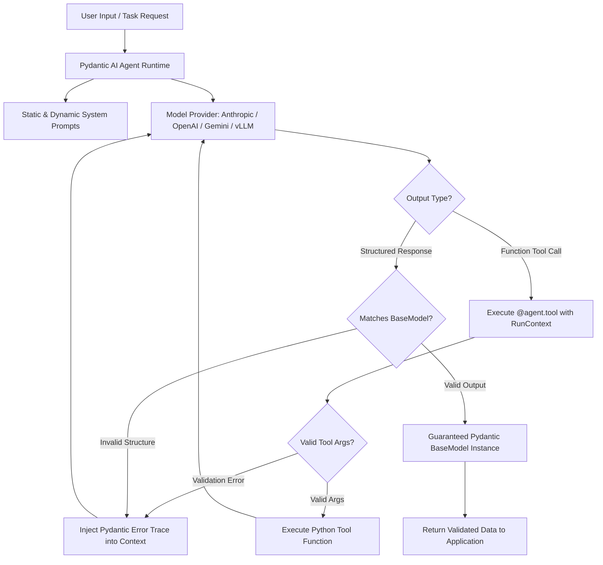
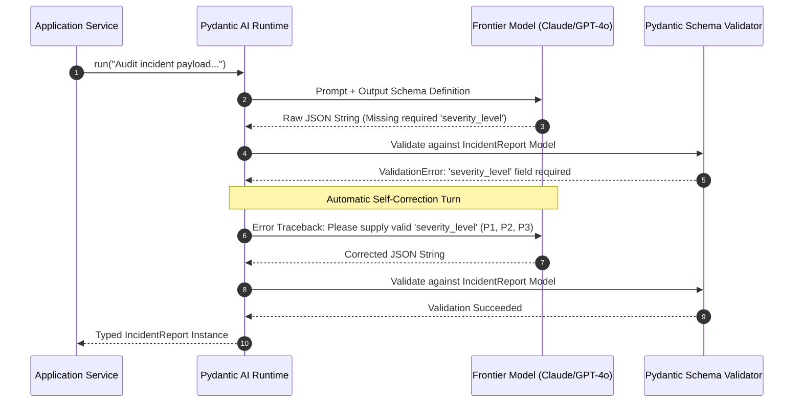

The transition from exploratory LLM prototyping to reliable enterprise deployment requires deterministic software contracts. Early generative AI engineering relied heavily on loose string manipulation, prompt-wrapped JSON scrapers, and fragile retry decorators. **Pydantic AI** establishes a fundamental architectural shift by grounding autonomous agent workflows in Python's standard type system and Pydantic's proven schema validation engine.

Building agents with Pydantic AI eliminates the architectural bloat associated with legacy meta-frameworks. By structuring agents around explicit input schemas, runtime dependency injection, and deterministic validation retries, development teams can build self-correcting agent loops that operate reliably inside production backend services.

---

## What Is Pydantic AI?

Pydantic AI is a type-safe, lightweight agent framework created by the authors of Pydantic to bring model orchestration directly into idiomatic Python. Rather than forcing developers into rigid Directed Acyclic Graph (DAG) abstractions, Pydantic AI treats agents as composable Python objects that integrate with existing FastAPI services, database connection pools, and async worker pipelines.



### Core Architecture Pillars

1. **Native Type Safety**: Every system prompt parameter, injected dependency, tool argument, and final response object is fully typed with Python standard typing hints (`typing.Annotated`, `dataclasses`, `pydantic.BaseModel`).
2. **Deterministic Self-Correction**: When an LLM generates invalid JSON or misformatted parameters, Pydantic AI automatically feeds the exact validation error back to the model for inline correction.
3. **First-Class Dependency Injection**: Securely inject database connections, authenticated user sessions, and API clients into tools without relying on global state or ambient closures.
4. **Model Agnostic Abstraction**: Switch between OpenAI GPT-4o, Anthropic Claude 3.7 Sonnet, Google Gemini 2.5 Flash, or locally hosted Ollama/vLLM models with zero modifications to tool definitions or schema structures.

---

## Environment Setup and Installation

Pydantic AI requires Python 3.10 or higher. For enterprise production systems, deploying with a lightweight footprint is recommended to avoid unnecessary transitive dependencies.

```bash
# Standard installation with core providers
pip install pydantic-ai

# Or using uv (recommended for high-speed deterministic dependency resolution)
uv add pydantic-ai

# Optional: Install with Pydantic Logfire for production telemetry
uv add "pydantic-ai[logfire]"
```

Configure your environment variables for your chosen model providers:

```bash
export ANTHROPIC_API_KEY="sk-ant-api..."
export OPENAI_API_KEY="sk-proj-..."
export GEMINI_API_KEY="AIzaSy..."
```

---

## Building Your First Type-Safe Agent

A basic Pydantic AI agent requires an LLM provider identifier and an optional system prompt. Execution can run synchronously via `run_sync()` or asynchronously via `run()`.

```python
from pydantic_ai import Agent

# Define the agent with Claude 3.7 Sonnet
analyst_agent = Agent(
    'anthropic:claude-3-7-sonnet',
    system_prompt=(
        "You are an expert infrastructure reliability engineer. "
        "Analyze technical system metrics and provide actionable root-cause hypotheses."
    )
)

# Execute the agent synchronously
response = analyst_agent.run_sync(
    "Our Postgres primary CPU spiked to 98% during a batch checkout job. "
    "Active connections jumped from 40 to 450 in 3 minutes."
)

print(response.output)
```

In this baseline example, Pydantic AI manages the API handshake, message formatting, and response unpacking. The agent operates idempotently without modifying state.

---

## Structured Output Validation with Self-Correction

Unstructured string outputs are a primary point of failure in automated systems. Pydantic AI solves this by binding an `output_type` directly to a Pydantic `BaseModel`.



### Implementing Structured Schemas

```python
from enum import Enum
from typing import List
from pydantic import BaseModel, Field
from pydantic_ai import Agent

class IncidentSeverity(str, Enum):
    P1 = "critical_outage"
    P2 = "degraded_performance"
    P3 = "minor_issue"

class RemediationStep(BaseModel):
    step_number: int = Field(description="Order of execution")
    action: str = Field(description="Terminal command or specific infrastructure adjustment")
    estimated_time_minutes: int = Field(description="Expected time to apply action")
    requires_approval: bool = Field(description="Whether elevated SRE approval is required")

class IncidentAuditReport(BaseModel):
    service_name: str = Field(description="Target microservice identifier")
    severity: IncidentSeverity = Field(description="Classified incident level")
    root_cause_summary: str = Field(description="2-3 sentence technical root cause analysis")
    affected_components: List[str] = Field(description="List of impacted database tables, queues, or services")
    remediation_plan: List[RemediationStep] = Field(description="Sequential steps to restore service")

# Bind schema directly to the agent
audit_agent = Agent(
    'openai:gpt-4o',
    output_type=IncidentAuditReport,
    system_prompt="Analyze production log anomalies and produce strict audit reports."
)

raw_telemetry = """
[ERROR] 2026-10-30 01:14:02 auth-gateway: Redis connection pool exhausted.
[WARN]  2026-10-30 01:14:05 payment-router: Downstream token verification timed out (504 Gateway Timeout).
[ERROR] 2026-10-30 01:14:12 auth-gateway: Worker threads blocked waiting for socket acquisition. Max connections: 500.
"""

result = audit_agent.run_sync(f"Analyze this outage data:\n{raw_telemetry}")

# The response.output is guaranteed to be an instance of IncidentAuditReport
report: IncidentAuditReport = result.output
print(f"Service: {report.service_name}")
print(f"Severity: {report.severity.value}")
print(f"Total Steps: {len(report.remediation_plan)}")
for step in report.remediation_plan:
    print(f"  [{step.step_number}] {step.action} (Approval: {step.requires_approval})")
```

If the model attempts to generate an unrecognized severity string like `"critical"` instead of one of the defined `IncidentSeverity` enum values, Pydantic AI detects the mismatch, initiates a corrective retry turn with the validation errors, and returns a verified object instance.

---

## Function Tool Calling with Type Enforced Signatures

Tools give agents the ability to interact with real-world infrastructure. In Pydantic AI, any standard Python function decorated with `@agent.tool` automatically becomes a model-callable tool with full docstring parsing and schema enforcement.

```python
import sqlite3
from typing import Dict, Any
from pydantic_ai import Agent, RunContext

agent = Agent('anthropic:claude-3-7-sonnet')

@agent.tool
def query_latency_metrics(service_id: str, window_minutes: int) -> Dict[str, Any]:
    """Retrieve p50, p95, and p99 latency metrics for a designated service.
    
    Args:
        service_id: The unique identifier of the target service (e.g. 'auth-service', 'billing-api').
        window_minutes: Historical lookup window in minutes (maximum 60).
    """
    # Simulated telemetry database query
    if window_minutes > 60:
        return {"error": "Window cannot exceed 60 minutes. Truncated to 60."}
        
    return {
        "service": service_id,
        "window_minutes": window_minutes,
        "p50_ms": 14.2,
        "p95_ms": 84.1,
        "p99_ms": 340.8,
        "error_rate_percent": 0.04
    }

response = agent.run_sync("Check the latency degradation on auth-service over the past 30 minutes.")
print(response.output)
```

The model reads the docstrings, inspects parameter types, formats the JSON tool call, receives the dictionary response, and synthesizes the final diagnosis.

---

## Enterprise Dependency Injection via RunContext

In enterprise architectures, tool functions cannot rely on static imports or hardcoded database connections. Tools must access runtime state, such as current tenant IDs, user permissions, database transactions, and HTTP client sessions.

Pydantic AI solves this through typed dependency injection using `RunContext[DepsT]`.

```python
from dataclasses import dataclass
import httpx
from pydantic_ai import Agent, RunContext

@dataclass
class SREDependencies:
    org_id: str
    user_email: str
    http_client: httpx.Client
    cluster_environment: str

sre_agent = Agent(
    'openai:gpt-4o',
    deps_type=SREDependencies,
    system_prompt="You are an autonomous operations copilot with access to cluster telemetry."
)

@sre_agent.tool
def restart_pod(ctx: RunContext[SREDependencies], pod_name: str, namespace: str) -> str:
    """Trigger a graceful rolling restart of a Kubernetes pod.
    
    Args:
        pod_name: Exact pod deployment name.
        namespace: Kubernetes namespace.
    """
    deps = ctx.deps
    
    # Enforce enterprise environmental guardrails
    if deps.cluster_environment == "production" and not deps.user_email.endswith("@company.com"):
        return f"Permission Denied: User {deps.user_email} cannot execute restarts in {deps.cluster_environment}."
        
    # Execute actual authenticated API call using injected client
    return f"Successfully initiated restart for {pod_name} in namespace {namespace} on cluster {deps.cluster_environment} for org {deps.org_id}."

# Instantiate dependencies per request
runtime_deps = SREDependencies(
    org_id="tenant_94812",
    user_email="ops-lead@company.com",
    http_client=httpx.Client(),
    cluster_environment="production"
)

result = sre_agent.run_sync(
    "Please restart the hung auth-worker pod in the security namespace.",
    deps=runtime_deps
)

print(result.output)
```

This pattern isolates credentials and session lifecycles, ensuring thread safety across concurrent web requests in high-throughput FastAPI deployments.

---

## Real-Time Token and Structured Streaming

For user-facing interfaces such as terminal consoles or web dashboards, waiting for full model completion introduces unacceptable latency. Pydantic AI provides native async streaming support.

```python
import asyncio
from pydantic_ai import Agent

agent = Agent('anthropic:claude-3-7-sonnet')

async def main():
    prompt = "Write an architectural overview comparing eBPF network filtering to iptables."
    
    print("Streaming generation:\n")
    async with agent.run_stream(prompt) as response:
        async for text_chunk in response.stream_text():
            print(text_chunk, end="", flush=True)
            
if __name__ == "__main__":
    asyncio.run(main())
```

---

## Unit Testing with TestModel

A common blocker for enterprise AI adoption is the inability to test agent logic deterministically without incurring API billing or introducing network latency in CI/CD pipelines. Pydantic AI includes a native `TestModel` backend for testing.

```python
import pytest
from pydantic import BaseModel
from pydantic_ai import Agent
from pydantic_ai.models.test import TestModel

class SecurityScore(BaseModel):
    score: int
    passed: bool

security_agent = Agent(
    'openai:gpt-4o',
    output_type=SecurityScore
)

def test_security_agent_deterministic_mock():
    # Swap out live LLM provider for TestModel
    test_model = TestModel(
        custom_output_args={
            'score': 95,
            'passed': True
        }
    )
    
    with security_agent.override(model=test_model):
        result = security_agent.run_sync("Review firewall configuration.")
        assert result.output.score == 95
        assert result.output.passed is True
```

This testing pattern enables fast, isolated unit test suites that verify schema compliance, tool registration, and business routing logic inside GitHub Actions without API keys.

---

## Observability and Distributed Tracing with Pydantic Logfire

Operating agents in production requires tracing multi-turn execution flows, token burn rates, and tool latencies. Pydantic AI provides zero-configuration integration with **Pydantic Logfire**, built directly on OpenTelemetry standards.

```python
import logfire
from pydantic_ai import Agent

# Initialize Logfire telemetry
logfire.configure(pds_client=True)

agent = Agent('anthropic:claude-3-7-sonnet')

# All agent runs, tool calls, and retries are automatically traced
result = agent.run_sync("Diagnose memory leak in worker pool.")
```

Logfire captures:
* End-to-end trace waterfalls showing prompt prefill vs tool execution duration.
* Exact prompt string modifications across corrective retry turns.
* Token count consumption broken down by prompt, completion, and tool response payloads.
* Python exception traces when tool invocations fail.

---

## Framework Comparison: Architectural Matrix

Choosing the right agent framework depends on your tech stack, concurrency demands, and tolerance for abstraction layers.

| Feature / Dimension | Pydantic AI | LangChain / LangGraph | CrewAI | Vercel AI SDK |
| :--- | :--- | :--- | :--- | :--- |
| **Primary Language** | Python (Type-Safe) | Python / TypeScript | Python | TypeScript / JavaScript |
| **Architecture Paradigm** | Functional / Typed Object | Graph DAG (`StateGraph`) | Role-Playing Personas | UI Hooks & Stream Primitives |
| **Validation Mechanism** | Native Pydantic BaseModels | Optional Output Parsers | Regex / String Heuristics | Zod Schemas |
| **Self-Correction** | Automatic Inline Retry Loop | Manual Graph Conditional Edges | Sequential Agent Review | Manual Retry Handling |
| **Dependency Injection** | Native (`RunContext`) | State Dictionary (`State`) | Task Context Objects | Request Scope Middleware |
| **Observability** | OpenTelemetry / Logfire | LangSmith | AgentOps / Third-party | Vercel Analytics / OTel |
| **Mock Testing Support** | Built-in `TestModel` | Mock LLM Wrappers | Custom Test Mocks | Mock Streams |
| **Learning Curve** | Low (Standard Python) | High (Custom Graph DSL) | Medium (Role Abstractions) | Low (React/Next.js) |

---

## Production Best Practices and Common Pitfalls

### Best Practices

1. **Keep Tool Functions Pure and Small**: Design tools to perform one task cleanly. Return compact JSON dictionaries rather than sprawling unstructured text to preserve context window tokens.
2. **Explicit Type Annotations**: Always declare type hints on all tool arguments and return values. Pydantic AI uses these annotations to generate the function-calling schema sent to the LLM.
3. **Use Descriptive Docstrings**: The model decides whether to call a tool based on its docstring. Include clear explanations of what the tool does, what each argument represents, and any usage constraints.
4. **Configure Explicit Timeouts**: Wrap external tool requests in short HTTP timeouts (`httpx.Timeout(5.0)`) to prevent a hanging third-party service from deadlocking the agent loop.

### Common Pitfalls to Avoid

* **Overly Strict Pydantic Constraints on Intermediate Steps**: Applying excessive regex patterns or restrictive validation to exploratory fields can cause an agent to fail unnecessarily. Reserve strict validation for final `output_type` models.
* **Leaking Sensitive State in System Prompts**: Avoid embedding production secrets, database credentials, or tenant tokens in system prompt strings. Use `RunContext` to provide secure access to tools.
* **Ignoring Model Token Limits**: In long-running multi-turn tool loops, the context window can fill up quickly. Monitor token counts and implement turn limits or session checkpoints.

---

## Production Deployment Checklist

- [ ] Agent instantiated with explicit provider prefix (`'anthropic:claude-3-7-sonnet'`, `'openai:gpt-4o'`).
- [ ] Final response structure modeled with a validated `pydantic.BaseModel` using `output_type`.
- [ ] All `@agent.tool` functions fully typed with detailed Google- or Sphinx-style docstrings.
- [ ] Database pools, credentials, and user context injected through `RunContext[DepsT]`.
- [ ] Unit tests implemented using `TestModel` without outbound network calls.
- [ ] OpenTelemetry or Pydantic Logfire configured for distributed tracing and token tracking.
- [ ] Fallback error handling implemented to catch unrecoverable model failures gracefully.

Pydantic AI establishes a cleaner, type-safe foundation for autonomous agent engineering, providing the structure and reliability required for production deployments.

