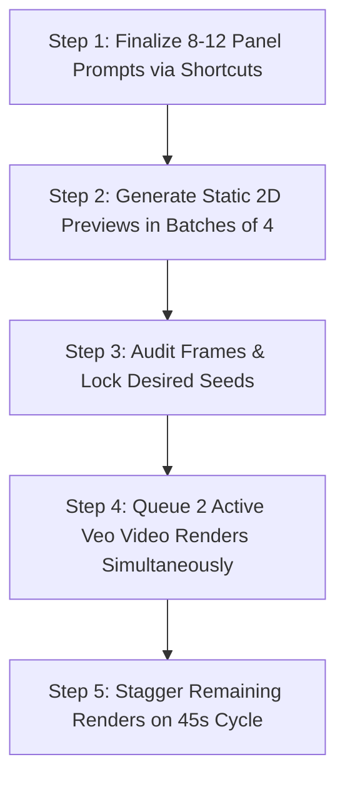

> **Direct Answer for Power Users:** To **automate Google Flow workflows**, structure your pre-production pipeline into three automated stages: **1) Batch Script Pre-Processing** using Python or LLM regex scripts to inject Fountain camera tags, **2) Keyboard-Driven Prompt Expansion** using Chrome snippet extensions to paste standardized character anchors in under one second, and **3) Cloud Media Batch Export** to download entire scenes as numbered MP4 sequences with matching EDL timeline markers.

Creating a 3-shot scene in Google Flow is effortless. However, when managing a 60-shot feature animatic or producing daily vertical video content, manually copying character descriptions, tweaking camera dropdowns, and downloading individual video clips becomes a major bottleneck.

By integrating lightweight text expanders, formatted script parsers, and batching shortcuts, you can streamline your workflow and cut production time in half.

Here is the exact automation stack used by high-output AI production studios.

---

## 1. Automated Script Pre-Processing: The Fountain Compiler

Instead of manually typing bracketed camera directives inside Google Flow, use a simple prompt template or Python script to pre-tag your screenplay.

[SCREENSHOT: Terminal window running a screenplay formatting script that outputs structured Fountain text with shot tags]

### The Script Formatting Automation Prompt (Use in ChatGPT / Gemini)
```text
SYSTEM: You are a Hollywood Director of Photography preparing a script for Google Flow Storyboard Studio.
TASK: Take the following raw narrative text and convert it into strict Fountain screenplay syntax.
RULES:
1. Divide continuous action into sequential 4-second beats.
2. Insert bracketed cinematography tags at the beginning of each beat: [WIDE ESTABLISHING], [MEDIUM TWO-SHOT], [OVER-THE-SHOULDER], [TIGHT CLOSE-UP], or [KINETIC TRACKING].
3. Ensure all character names are strictly capitalized.
4. Output exclusively raw UTF-8 plain text with zero markdown commentary.
```

To maintain a distraction-free writing environment when generating scripts in browser tools, keep your workflow clean using our [ChatGPT ad and promo blocker tutorial](https://nadhebe.com/tutorials/how-to-block-chatgpt-ads-promos-chrome-brave/).

---

## 2. Chrome Extension Shortcuts: Instant Character Anchor Injection

Typing your 40-word character anchor description into 15 consecutive panel cards introduces human error and character drift.

[SCREENSHOT: Browser popup showing keyboard macro expanding `/elena` into the complete character anchor string]

### Setup Text Blaze / Magical Chrome Extension:
1. Install a text expansion extension (such as **Text Blaze** or **Magical** from the Chrome Web Store).
2. Create a snippet trigger for each primary character:
   - Shortcut: `/elena`
   - Replacement Text: `ELENA (32yo Hispanic woman, dark espresso hair in sleek low ponytail, charcoal wool trench coat, hazel eyes)`
3. Create cinematography shortcuts:
   - Shortcut: `/dolly` $\rightarrow$ `Slow cinematic dolly forward, 50mm lens, shallow depth of field, warm golden hour illumination, photorealistic 35mm film grain`
   - Shortcut: `/drone` $\rightarrow$ `High-altitude aerial drone push-in, 21mm wide-angle lens, expansive landscape scale, smooth flight path`
4. Now, when building your storyboard in Step 3, typing `/elena` and `/dolly` instantly populates the panel prompt with your verified, consistent tokens in under two seconds.

---

## 3. Batching Generation Queues Without Server Disconnections

Google Flow enforces server-side concurrency limits to maintain TPU cluster stability. Submitting too many renders at once can result in stalled progress bars.



### The 4-at-a-Time Rule
1. Do not trigger video renders on an entire scene simultaneously.
2. Render **static 2D frame previews** across all panels first. Static frames render in ~5 seconds and consume only 1 credit.
3. Review your sequence. Click the **Padlock (Seed Lock)** icon on approved panels.
4. Trigger **Google Veo video generation** in pairs of two. As the first pair finishes rendering (~40 seconds), trigger the next two. This prevents WebSocket timeouts and avoids getting stuck at 99%, as covered in our [Google Flow troubleshooting guide](https://nadhebe.com/tutorials/google-flow-storyboard-studio-not-working/).

---

## 4. One-Click Asset Management and EDL Timeline Exports

Once your sequence is rendered, avoid downloading video clips one by one.

[SCREENSHOT: Google Flow Media Bin drawer showing Batch Export options: ZIP Package, EDL Timeline, and PDF Director's Deck]

### Exporting for Professional Post-Production
1. Open the **Media Bin** in the bottom left drawer.
2. Click **Select All Completed Videos**.
3. Choose **Download Batch (ZIP)**: Google Flow automatically names clips chronologically (`Scene_01_Shot_01.mp4`, `Scene_01_Shot_02.mp4`), saving you from manual file renaming.
4. Click **Export Timeline EDL**: Import this EDL directly into **Adobe Premiere Pro**, **DaVinci Resolve**, or **Final Cut Pro**. The editing software will automatically place the clips on your timeline with exact 4.0-second durations, ready for sound design, voiceover scoring, and color grading.

---

## The Automated Pre-Production Pipeline Summary

| Production Phase | Manual Approach (Slow) | Automated Approach (Fast) | Time Saved |
| :--- | :--- | :--- | :--- |
| **Script Breakdown** | Manual typing & formatting | Fountain compiler prompt template | 70% |
| **Character Tagging** | Re-typing descriptions per shot | Chrome snippet expanders (`/char`) | 85% |
| **Framing Selection** | Guessing descriptive adjectives | Standardized cinematography shortcuts | 60% |
| **Asset Download** | Clicking and downloading one-by-one | Batch ZIP + EDL timeline export | 90% |

Automating repetitive mechanical steps frees you to focus on what truly matters: pacing, emotion, and visual storytelling.

