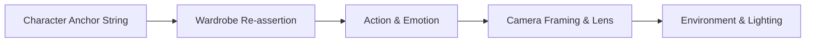

> **Direct Answer for Creators:** To **keep characters consistent in Google Flow**, upload a high-resolution frontal portrait in **Step 2 (Character Setup)** and define an immutable **Anchor Prompt Formula** covering exact facial features, hairstyle, and wardrobe materials. In **Step 3 (Shot Breakdown)**, always place the character's full anchor string at the very start of every panel prompt before describing camera motion or action. For video clips, lock seed parameters and reference the same asset binder across all scenes.

The single biggest tell of an amateur AI-generated film is **character drift**—a protagonist who has short brown hair and a leather jacket in a wide establishing shot, but suddenly appears with wavy blonde hair and a denim jacket in the close-up conversation that follows.

Google Flow Storyboard Studio was engineered specifically to solve multi-shot continuity. By leveraging Google Labs asset binders and multi-modal reference embeddings, you can lock character identity across an entire 20-shot production.

Here is the exact step-by-step production workflow to achieve rock-solid character consistency.

---

## 1. The Anatomy of Character Drift: Why AI Video Forgets Faces

Diffusion models and video transformers like Google Veo generate frames by progressively removing noise conditioned on text tokens and reference vectors. When you advance to a new shot, the model interprets the new prompt independently unless explicitly anchored.

[SCREENSHOT: Side-by-side comparison of drifting character faces vs perfectly locked characters across 3 storyboard panels]

Character drift happens for three main reasons:
1. **Generic Character Descriptors:** Words like *"young handsome detective"* yield thousands of equally valid visual interpretations.
2. **Camera Distance Distortion:** When camera distance changes (e.g., from wide shot to medium close-up), the model shifts token attention from wardrobe and body posture to facial pores and eye reflections.
3. **Lighting Contamination:** Strong environmental lighting tags (e.g., *"dramatic crimson neon rim light"*) can override skin tone, hair color, and costume textures.

---

## 2. Step 1: Crafting an Unbreakable Character Anchor Formula

Before typing your first storyboard scene, you must write a **Standardized Character Anchor**. This anchor must be pasted verbatim into every panel where your character appears.

### The 4-Part Anchor Formula

```
[Name]: [Age Bracket + Exact Ethnicity], [Haircut + Hair Color + Parting], [Distinct Facial Feature], [Exact Wardrobe Material & Color Palette]
```

### Production Example 1: Modern Cinematic Thriller
```text
ELENA: A 32-year-old Hispanic woman, sharp angular jawline, dark espresso hair styled in a sleek low ponytail with a middle part, warm hazel eyes, wearing a tailored charcoal wool trench coat over a cream silk mock-neck blouse.
```

### Production Example 2: Sci-Fi / Cyberpunk Action
```text
MARCUS: A 40-year-old Black man, close-cropped fade haircut, silver prosthetic cybernetic optical implant over left eyebrow, short salt-and-pepper boxed beard, wearing a weathered olive-drab tactical utility vest with matte black buckle straps over a slate grey combat hoodie.
```

> [!TIP]
> Notice the absence of subjective adjectives like *"beautiful"*, *"stylish"*, or *"cool"*. Use concrete nouns and exact physical materials. The model cannot hallucinate variations if every surface attribute is strictly bounded.

---

## 3. Step 2: Uploading and Tagging Reference Image Binders

Google Flow's character workflow in Step 2 allows you to bind visual reference files directly to your character's token ID.

[SCREENSHOT: Google Flow Character Setup panel showing the front portrait, side profile, and 3/4 angle reference upload slots]

### How to Prepare Reference Images
1. **Generate a 3-View Turnaround Sheet:** Use Google Flow or an external image generator to generate a frontal portrait, a 45-degree three-quarter view, and a side profile under neutral studio lighting.
2. **Remove Complex Backgrounds:** Ensure reference portraits feature a solid neutral grey or white background so environmental reflections do not bleed into your scenes.
3. **Bind the Asset:** In Google Flow **Step 2 (Character Setup)**, click **Add Character**, assign the name matching your script, and upload the front-facing portrait as the primary anchor.
4. **Link Identity Tag:** Verify that the blue **Linked Asset** badge appears next to the character's name in your project drawer, as shown in our [complete Google Flow Storyboard Studio guide](https://nadhebe.com/tutorials/google-flow-storyboard-studio-guide/).

---

## 4. Step 3: Structuring Panel Prompts for Zero Character Mutation

When you write panel prompts in Step 3, the order of your words determines how the model allocates attention weights.



### The Prompt Architecture Hierarchy
1. **Primary Anchor (Tokens 1–25):** Character name and immutable physical description.
2. **Wardrobe Check (Tokens 26–35):** Reiterate outerwear and color to avoid wardrobe drift.
3. **Action & Expression (Tokens 36–55):** What the character is actively doing and feeling.
4. **Cinematography (Tokens 56–75):** Shot size (e.g., Medium Close-Up), lens focal length (e.g., 50mm anamorphic), and lighting.

### Good vs. Bad Panel Prompts

| Shot Type | Weak Prompt (Causes Character Drift) | Production Anchor Prompt (Guarantees Consistency) |
| :--- | :--- | :--- |
| **Shot 01: Establishing Wide** | *"A detective standing on a rainy city street looking at a skyscraper."* | `ELENA (32yo Hispanic woman, dark espresso hair in sleek low ponytail, charcoal wool trench coat), standing on rain-soaked asphalt, looking up at glass skyscraper. Extreme wide shot, 24mm anamorphic lens, cold blue streetlamp illumination.` |
| **Shot 02: Medium Close-Up** | *"Close-up of the woman looking worried as sirens flash."* | `ELENA (32yo Hispanic woman, sleek low ponytail, charcoal wool trench coat collar visible), tense expression, furrowed brow. Medium close-up, 50mm lens, shallow depth of field, red police beacon reflections across wet pavement.` |
| **Shot 03: Over-the-Shoulder** | *"Over the shoulder shot of someone talking to a witness."* | `Over-the-shoulder shot framing ELENA from behind (charcoal wool trench coat collar, low espresso ponytail visible), facing shopkeeper across counter. Cinematic warm fluorescent indoor lighting, 35mm lens.` |

---

## 5. Step 4: Animating Characters in Google Veo Without Facial Warping

Once your static storyboard panels are generated, clicking **Generate Video** sends the panel to Google Veo for 4-second motion synthesis.

[SCREENSHOT: Google Veo video generation settings modal highlighting the Motion Strength slider and Reference Weight toggle]

### Crucial Veo Settings for Continuity
- **Motion Strength (Set to 3 or 4 / 10):** High motion values (> 7) cause latent vectors to tear, resulting in facial warping and shifting eye shapes. Moderate motion values preserve facial geometry while delivering natural blinking, breathing, and head turns.
- **Reference Image Weight (Set to High):** Ensure the initial storyboard frame is prioritized as the first keyframe (`i2v` / image-to-video mode) rather than allowing Veo to imagine new geometry from the text prompt alone.
- **Avoid Rapid Camera Rotations:** If a shot demands a 180-degree camera orbit, split the sequence into two distinct storyboard panels (Front View $\rightarrow$ Cut $\rightarrow$ Rear View) rather than attempting a single continuous spin in one 4-second prompt.
- If your video generation freezes during rendering, follow our troubleshooting steps for [Google Flow generation failures and stuck renders](https://nadhebe.com/tutorials/google-flow-storyboard-studio-not-working/).

---

## 6. Managing Multiple Characters in the Same Shot

When two distinct characters interact within the same storyboard panel (e.g., a dialogue scene between Elena and Marcus), AI models frequently blend their features—giving Elena Marcus's tactical vest or giving Marcus Elena's ponytail.

### How to Prevent Character Bleed
1. **Positional Spatial Anchors:** Explicitly state screen coordinates:
   ```text
   Two-shot dialogue: ELENA (left of frame, Hispanic woman, low ponytail, charcoal trench coat) faces MARCUS (right of frame, Black man, tactical utility vest, short beard).
   ```
2. **Contrasting Color Palettes:** Never dress two characters in similar colors or fabrics. If Elena wears charcoal wool, put Marcus in olive-drab tactical nylon or bright canvas.
3. **Use Single-Character Cutaways:** In fast-paced dialogue, rely on alternating Over-the-Shoulder (OTS) singles rather than persistent wide two-shots. Singles give the model 100% of its token budget to render one face accurately.
4. You can plan and organize these multi-character cutaways using visual cards, as demonstrated in our guide on [building pre-production storyboards in Google Flow](https://nadhebe.com/tutorials/building-pre-production-storyboards-google-flow/).

---

## Summary Character Consistency Checklist

- [ ] High-resolution neutral portrait uploaded to Step 2 Character Setup.
- [ ] Immutable 4-part anchor formula written (Age/Ethnicity, Hair, Unique Feature, Wardrobe).
- [ ] Anchor string pasted at the exact beginning of every panel prompt.
- [ ] Distinct wardrobe colors assigned across interacting characters.
- [ ] Veo Motion Strength dialed to 3–4 to prevent facial morphing during video generation.
- [ ] Seed numbers locked across sequential panels sharing the same scene lighting.

By standardizing your character anchors and structuring panel prompts around immutable tokens, your Google Flow storyboards will maintain the professional visual continuity required for high-end film previz and commercial pitches.

