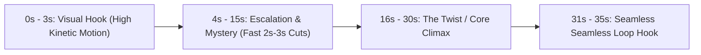

> **Direct Answer for Creators:** To **make a YouTube Short with Google Flow**, set your project aspect ratio to **9:16 Vertical** in project settings, write a 30-second script structured around a 3-second visual hook, and divide it into **8 to 10 distinct 4-second shots** in Storyboard Studio. Render each panel with Google Veo, download the 1080x1920 MP4 clips, and import them into an editor like CapCut or Premiere Pro to add trending audio, sound effects, and animated captions.

Short-form vertical video (YouTube Shorts, Instagram Reels, TikTok) is the fastest-growing surface for digital storytelling. However, shooting live-action footage or animating complex CGI scenes for every daily short is prohibitively expensive and time-consuming.

With **Google Flow Storyboard Studio** and **Google Veo**, you can script, storyboard, and generate a cinematic, high-retention vertical short in under an hour without touching a camera or 3D software.

Here is the complete step-by-step production blueprint from blank page to published Short.

---

## 1. The High-Retention YouTube Shorts Formula

YouTube's recommendation algorithm rewards one primary metric above all else: **Audience Retention Rate** (viewers watching past the 100% mark).



[SCREENSHOT: Vertical 9:16 storyboard deck showing sequential panels organized into Hook, Build, Climax, and Loop]

### The 4-Beat Structure
1. **The Visual Pattern Interrupt (0–3s):** No slow establishing shots. Open immediately with high-speed movement, an unusual visual anomaly, or an extreme close-up.
2. **The Escalation (4–15s):** Fast, rhythmic cuts every 2 to 3 seconds. Show, don't just tell.
3. **The Climax / Payoff (16–28s):** Reveal the answer to the curiosity hook presented in second 1.
4. **The Seamless Loop (29–32s):** Craft the final shot to match the camera vector and lighting of shot 1, encouraging viewers to watch the Short twice.

---

## 2. Step 1: Setting Up the 9:16 Vertical Canvas

By default, Google Flow opens in 16:9 cinematic widescreen. You must switch to vertical mode before generating images to prevent ugly black bars or cropped compositions.

1. Open **Google Flow** and click **New Project**.
2. Click **Project Settings (Gear Icon)** in the top right.
3. Change **Aspect Ratio** from `16:9 Landscape` to **`9:16 Vertical (1080x1920)`**.
4. Confirm your selection. The canvas panels will transform into vertical smartphone frames.

---

## 3. Step 2: Writing a 35-Second High-Impact Script

Keep dialogue minimal. In vertical video, visual pacing and sound design carry 80% of the narrative impact.

### Sample Script: "The Midnight Artifact"
```text
EXT. DEEP SPACE SALVAGE YARD - ZERO GRAVITY

[SHOT 1: EXTREME CLOSE-UP - HOOK]
A scarred astronaut helmet visor reflects an ominous glowing purple artifact floating in the void.

[SHOT 2: MEDIUM VERTICAL WIDE]
ASTRONAUT VANCE drifts backward through shattered spaceship bulkheads, reaching outward with a magnetic grapple claw.

[SHOT 3: FAST PUSH-IN - ACTION]
The grapple clamp locks onto the ancient alien cube. The purple glyphs violently pulse with electric arcs.

[SHOT 4: REACTION CLOSE-UP]
Vance's eyes widen behind the glass. Warning indicators flash red across his internal HUD.

[SHOT 5: WIDE VERTICAL ZOOM-OUT - TWIST]
The alien cube is not drifting alone—it is anchored to the eye of an enormous leviathan creature slumbering in the nebula behind him.
```

---

## 4. Step 3: Storyboarding and Character Anchoring

In vertical framing, characters occupy more vertical screen space than in horizontal cinema.

[SCREENSHOT: Vertical character profile turnaround displaying full-body posture and face framing]

- **Emphasize Verticality:** Use prompts that take advantage of vertical space: tall towering architecture, descending elevators, diving drones, and full-body wardrobe silhouettes.
- **Lock Character Continuity:** Paste your pre-defined character anchor tag into every shot panel to maintain facial and costume identity, following our [character consistency tutorial](https://nadhebe.com/tutorials/how-to-keep-characters-consistent-in-google-flow/).

---

## 5. Step 4: Generating Smooth Veo Video Clips

1. Advance to **Step 3 (Shot Breakdown)**.
2. Render a 1-credit static preview for each vertical card to confirm framing.
3. Once approved, click **Generate Video** to initiate Google Veo video synthesis.
4. Set **Motion Strength to 4**. For vertical video, avoid chaotic camera tilts that cause motion sickness on small mobile screens. Stick to clean vertical crane booms, smooth push-ins, and stable tracking shots.

---

## 6. Step 5: Final Assembly in CapCut or Premiere Pro

[SCREENSHOT: Video editing timeline showing video tracks, sound effect markers, voiceover audio, and kinetic subtitle layers]

1. **Download All MP4 Clips:** From the Google Flow Media Drawer, select all completed panels and click **Download Batch (1080p MP4)**.
2. **Import into Video Editor (CapCut / Premiere / Resolve):** Create a 1080x1920 vertical sequence at 30fps.
3. **Trim Dead Air:** Trim the first and last 0.2 seconds of each Veo clip to ensure cuts are snappy and action flows continuously.
4. **Generate Auto-Captions:** Apply bold, high-contrast subtitles (e.g., yellow and white text with a black outline) positioned in the upper-middle third of the screen—away from YouTube's interface buttons.
5. **Layer Sound FX (SFX):** Add swooshes on camera cuts, deep sub-bass rumbles under tense moments, and ambient room tone to elevate the visual realism.

---

## YouTube Shorts Publishing Best Practices

- **Upload at Native 1080x1920:** Never upscale to 4K if it introduces compression artifacts.
- **Select an Eye-Catching Thumbnail Frame:** In the YouTube mobile app upload screen, choose the most visually striking frame (usually Shot 1 or the Climax frame).
- **Write a Curiosity-Driven Title (< 50 Chars):** E.g., *"What did he just awaken in deep space? 😱"*
- **Add 3 Relevant Hashtags:** `#Shorts #AIFilmmaking #SciFiAnimation`

By combining Google Flow's rapid pre-production deck generation with Google Veo's video quality, you can produce daily, cinematic YouTube Shorts that stand out in crowded mobile feeds.

