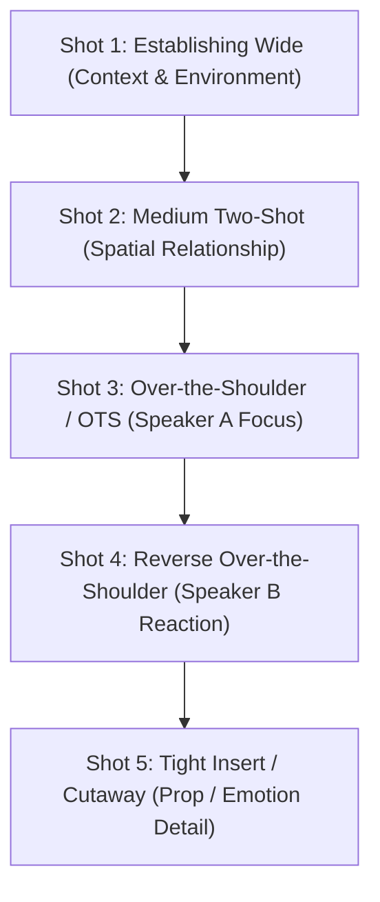

> **Direct Answer for Filmmakers:** To **turn any script into a Google Flow shot list**, format your screenplay in clean **Fountain plain text syntax** with clear `INT./EXT.` sluglines, character dialogue blocks, and bracketed camera directives (e.g., `[CLOSE-UP]`). Import the text into **Step 1 (Script Import)**, allow Storyboard Studio to extract character profiles, then refine each generated panel in **Step 3 (Shot Breakdown)** by assigning standard cinematography framing: establishing shot, medium two-shot, alternating close-ups, and cutaway inserts.

Translating a written screenplay into a visual shot list has historically taken directors and storyboard artists days of manual drawing and spreadsheet formatting. **Google Flow Storyboard Studio** automates this transition, taking raw dialogue and stage directions and compiling them into an interactive, multi-camera storyboard deck in under two minutes.

However, the quality of your storyboard output is directly governed by how well your script is structured before import. A poorly formatted script results in lumped paragraphs and missed coverage, while a properly tagged script produces a production-ready previz deck with zero manual re-typing.

Here is the complete end-to-end framework for converting any screenplay into a Google Flow shot list.

---

## 1. Screenplay Anatomy: What Google Flow Looks For

Google Flow's natural language parser does not read scripts like a human reader; it evaluates syntax tokens to establish scene boundaries and shot breaks.

[SCREENSHOT: Screenplay text breakdown highlighting Slugline, Action Block, Character Cue, and Parenthetical parsing tokens]

To get clean automatic panel division, your script must clearly separate four foundational elements:
1. **Scene Headings / Sluglines (`INT./EXT. LOCATION - TIME`):** Determines background environment and lighting parameters.
2. **Action Descriptions (Present Tense, Active Verbs):** Generates background props, character positions, and visual atmosphere.
3. **Character Names (ALL CAPS):** Binds characters to the project asset profiles established in Step 2.
4. **Bracketed Cinematography Directives (`[ANGLE / MOVEMENT]`):** Signals the parser to create a new shot panel rather than combining actions into a single static frame.

---

## 2. Converting Narrative Prose into Fountain Syntax

If your project starts as a novel chapter, treatment, or rough creative brief, convert it into **Fountain screenplay syntax** before importing into Google Flow.

### Raw Creative Brief (Avoid Importing Directly):
> *"Sarah runs down the neon alleyway while sirens wail behind her. She looks over her shoulder, terrified. She ducks behind a steel dumpster as a drone flys overhead with a bright searchlight."*

### Formatted Fountain Script (Ready for Google Flow):
```text
EXT. CYBER DISTRICT ALLEYWAY - NIGHT

Rain pours over cracked asphalt. Steam rises from sewer grates.

[WIDE ESTABLISHING TRACKING SHOT]
SARAH (28, soaked canvas trench coat, short copper hair) sprints down the claustrophobic alleyway. Red and blue emergency reflections sweep across the wet brick walls.

[LOW-ANGLE MEDIUM SHOT]
Sarah skids around a corner, breathing heavily. She glances over her shoulder in terror.

[EXTREME CLOSE-UP - EYES]
Sarah's pupils dilate as an intense white light illuminates her face from above.

[DRONE POV SHOT - DOWNWARD ANGLE]
A surveillance quadcopter hovers overhead, casting a cone of harsh searchlight down onto a rusted industrial dumpster. Sarah huddles in the shadows below.
```

When Google Flow parses this script, it automatically creates **four distinct storyboard panels** with pre-configured camera tags (`Wide Tracking`, `Low-Angle Medium`, `Extreme Close-Up`, and `Drone POV`) rather than one cluttered frame. If you encounter parser errors or missing buttons during import, consult our guide on [fixing Google Flow Storyboard Studio errors](https://nadhebe.com/tutorials/google-flow-storyboard-studio-not-working/).

---

## 3. The 5-Shot Cinematography Sequence: A Director's Formula

When breaking down any dramatic scene for Storyboard Studio, adhere to classic visual grammar. Every scene should feature this minimum 5-shot coverage hierarchy:



| Shot # | Framing Type | Purpose in Storyboard Studio | Google Flow Prompt Modifier |
| :--- | :--- | :--- | :--- |
| **01** | **Extreme Wide Shot (EWS)** | Establishes location, weather, and world scale. | `Extreme wide establishing shot, 21mm wide lens, vast landscape scale` |
| **02** | **Full Shot / Medium Wide** | Establishes character physical relationships and blocking. | `Medium wide full-body shot, characters framed from knees up, 35mm lens` |
| **03** | **Medium Close-Up (MCU)** | Delivers dialogue with clear emotional facial cues. | `Medium close-up shot, shallow depth of field, focused on face, 50mm lens` |
| **04** | **Over-the-Shoulder (OTS)** | Anchors conversation dynamics and eye lines. | `Over-the-shoulder shot looking past character A toward character B` |
| **05** | **Insert / Macro Detail** | Emphasizes critical plot objects (knife, clock, letter). | `Close-up macro insert shot, rack focus, tight detail on object` |

---

## 4. Step-by-Step Walkthrough: Building the Shot List in Google Flow

[SCREENSHOT: Google Flow Step 3 Shot Breakdown grid displaying panel cards, prompt editors, and camera angle selectors]

### Step 1: Ingest Script in Step 1
Navigate to Google Flow Storyboard Studio. Paste your formatted plain text script into the import box. Click **Analyze & Parse**.

### Step 2: Verify Character Asset Binders
Check that every character mentioned in your scene headings has been assigned an identity profile. As outlined in our tutorial on [how to keep characters consistent in Google Flow](https://nadhebe.com/tutorials/how-to-keep-characters-consistent-in-google-flow/), verify that the correct portrait reference is linked.

### Step 3: Review the Auto-Generated Shot Panels
Google Flow will populate the timeline with thumbnail cards. Review each card:
1. **Inspect the Camera Tag:** Click the camera icon on the thumbnail to toggle between Wide, Medium, Close-Up, Low Angle, and High Angle.
2. **Refine Action Prompt Text:** Ensure prompt modifiers describe active movement rather than static poses (e.g., *"dashing forward"* instead of *"standing"*).
3. **Set Expected Duration:** By default, Google Flow sets each panel to **4.0 seconds**, which maps directly to the standard generation duration of Google Veo.

### Step 4: Add Coverage and In-Between Panels
If a dialogue scene feels too abrupt, hover between Panel 02 and Panel 03 and click the **`+` (Insert Shot)** button. Add a reaction shot or environment cutaway to give your edit pacing room.

---

## 5. Exporting Your Shot List for Production Teams

Once your storyboard frames are approved, Storyboard Studio offers three export configurations:

1. **PDF Director's Binder:** Exports a printable grid containing panel thumbnails, scene headings, dialogue cues, shot types, and estimated timing. Ideal for pitching to producers and camera operators.
2. **EDL / XML Timeline Export:** Exports sequence timing markers for direct import into Adobe Premiere Pro, Final Cut Pro, or DaVinci Resolve.
3. **Batch Veo Video Renders:** Queue all panels to render as 1080p MP4 cinematic clips in parallel, ready for immediate assembly in an NLE timeline. Learn more about full pre-production workflows in our [complete guide to building pre-production storyboards in Google Flow](https://nadhebe.com/tutorials/building-pre-production-storyboards-google-flow/).

---

## Shot List Formatting Cheat Sheet

Keep these technical prompt prefixes handy when polishing your panels in Google Flow:

```text
-- CINEMATIC CAMERA FRAMING PRESETS --
[ESTABLISHING]: Extreme wide shot, architectural perspective, deep focus, f/8, daylight
[COWBOY SHOT]: Medium full shot, framed mid-thigh up, eye-level perspective, 35mm lens
[PORTRAIT MCU]: Medium close-up, creamy bokeh background, 85mm portrait prime lens, f/1.8
[TIGHT CHOKER]: Extreme close-up on eyes and mouth, high emotional tension, macro 100mm lens
[LOW DUTCH TILT]: Low-angle canted Dutch angle, 15-degree tilt, dramatic menacing perspective
[CRANE BIRDS-EYE]: High overhead 90-degree top-down perspective, geometric composition
```

Mastering script-to-shot translation ensures your creative vision transfers seamlessly from paper to visual storyboard, eliminating guesswork before rendering video clips in Google Veo.

